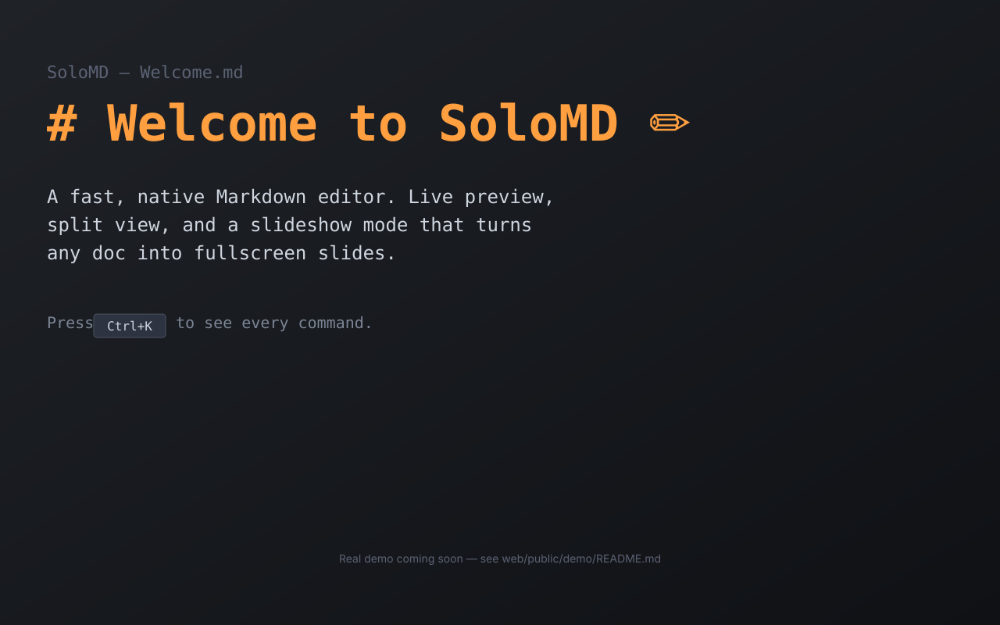
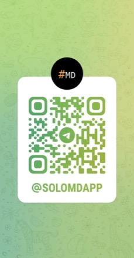

# SoloMD

> All the calm of Typora. Plus 5-platform vault sync, 9-format export & local AI — free.

[](https://github.com/zhitongblog/solomd/releases/latest)
[](LICENSE)
[](https://github.com/zhitongblog/solomd/releases)
[](https://github.com/zhitongblog/solomd/stargazers)
[](https://atomgit.com/zhitongblog/solomd)
[](https://solomd.app)

🌐 **[中文](README.zh.md) · [日本語](README.ja.md) · [한국어](README.ko.md) · [Deutsch](README.de.md) · [Français](README.fr.md) · [Español](README.es.md) · [Português](README.pt.md) · [Italiano](README.it.md) · [Polski](README.pl.md) · [Nederlands](README.nl.md) · [Türkçe](README.tr.md) · [Svenska](README.sv.md) · [Українська](README.uk.md)** · 🪞 **[AtomGit mirror →](https://atomgit.com/zhitongblog/solomd)** · **[Gitee mirror →](https://gitee.com/zhitong45/solomd)** (faster downloads from China)

[**Download v5.2.0**](https://github.com/zhitongblog/solomd/releases/latest) · [**AtomGit Releases**](https://atomgit.com/zhitongblog/solomd/releases) · [**What's new in v5.2**](https://solomd.app/whats-new/) · [**Compare vs Obsidian & Typora**](https://solomd.app/compare/) · [**Website**](https://solomd.app) · [**Security**](https://solomd.app/security)

⭐ **If SoloMD earns a place on your machine, [star it on GitHub](https://github.com/zhitongblog/solomd)** — it's free, made by one developer, and stars are how other people find it.



> ### 🤖 Built and maintained by Claude
>
> SoloMD is written, tested and released almost entirely by **Claude Code**, Anthropic's
> coding agent, working under a human maintainer who sets the direction and decides what
> ships. **Issues and pull requests are triaged and answered by Claude as well** — the
> replies you get here are written by an AI, not typed by a person.
>
> We are telling you this for two reasons. You should know what you are trusting with your
> notes: read the code, it is MIT and all of it is public. And when a reply is confidently
> wrong — it happens — say so in the thread. That correction is the mechanism.
>
> **💼 For Teams & Founders (100% Async Contracts):** Using this exact human-architect + Claude Code pipeline, the maintainer also built **[Unterm](https://unterm.app)** — a self-developed Rust + wgpu terminal kernel exposing 152 MCP methods with an Action Gateway. Available for **100% asynchronous remote contracts** (custom MCP servers, Rust/Tauri agentic desktop apps, and AI workflows — written specs, Loom demos & clean PRs, zero meetings). [**Work with the architect →**](https://doaipm.com/en/about/?utm_source=solomd_readme#work-with-me)

Your notes live in a plain folder. **SoloMD gives you Typora’s quiet, centered writing feel, Obsidian’s local-first vault links, free encrypted sync across all 5 platforms, built-in 9-format export, and zero-config local AI + a 16-tool MCP server.**

Built on Tauri 2 + Vue 3 + CodeMirror 6 + Rust. ~14 MB on Windows, ~16 MB on Linux (`.deb`/`.rpm`), ~21 MB on Android (`arm64`), and ~30 MB for the dual-arch macOS Universal `.dmg`. Free, MIT-licensed, no account, no subscription, no plugin tax, no SoloMD-hosted servers. Your notes, AI keys, embeddings index, and git history stay on your device.

## What's new in v5.0 – v5.2

- **Three seamless writing modes (`v5.2`)** — Switch anytime between **Pure WYSIWYG** (Markdown syntax markers stay completely hidden even on the active caret line), **Live Preview** (markers reveal only on the active line), and synced **Split / Source** view.
- **Unified 9-Format Export Center (`v5.2`)** — One modal with live preview exports **PDF** (with KaTeX & Mermaid), **Word (`.docx`)**, **HTML**, **EPUB**, **LaTeX**, **ODT**, **RTF**, **Plain Text**, and **Markdown** out of the box — **zero external Pandoc installation required**.
- **Zero-config local AI (OPR) + 20+ BYOK providers (`v5.2`)** — One-click Open Provider Registry (OPR) auto-discovery detects local **Ollama**, **LM Studio**, **Jan**, **vLLM**, and **llama.cpp** servers on localhost. Or plug in your own API key for 20+ cloud providers (OpenAI, Claude, Gemini, DeepSeek, Qwen, GLM, Kimi, Doubao, MiniMax, Groq, Mistral, xAI, SiliconFlow, OpenRouter, etc.) stored in your OS keychain.
- **Vault-scoped encrypted Cloud & Git sync (`v5.2`)** — Bind each workspace independently to **iCloud Drive**, **OneDrive**, **Nutstore**, **Baidu/Aliyun Drive**, **Syncthing**, **WebDAV**, **S3 / Cloudflare R2**, or **GitHub / GitLab / Gitea** — with optional **AES-256-GCM / XChaCha20-Poly1305** end-to-end encryption and conflict copy protection.
- **Lightweight declarative JSON extensions (`v5.2`)** — Drop simple JSON manifests into `<workspace>/.solomd/plugins/*.json` (or manage via *Settings → Extensions*) to add custom `/` slash templates, regex/template Command Palette transforms, and one-click Webhook publishers — zero Electron plugin bloat.
- **CLI v2 & 16-tool MCP server (`v5.2`)** — `solomd open / new / list / search / export / daily / agent / mcp` from your terminal, plus `solomd-mcp` with multi-vault `--workspace` federation.

## Three pillars in one lightweight native app

1. **Calm writing & publishing.** Pure WYSIWYG + Live Preview + Split view, floating selection formatting bar, Focus & Typewriter modes, fullscreen Slideshow (`⌘⌥P`), Vim mode, KaTeX math + Mermaid diagrams, image paste to `_assets/`, built-in 9-format export, and `.docx / .pdf / .xlsx / .pptx` drag-and-drop import to Markdown. First-class CJK encoding detection (UTF-8 / GBK / Big5 / Shift-JIS), character counts, and Simplified ↔ Traditional conversion.
2. **Connected local vault across 5 platforms.** Native apps for **macOS, Windows (x64 + ARM64), Linux (x64 + ARM64), iOS/iPadOS, and Android** with cross-device session restore. `[[Wikilinks]]`, backlinks, YAML frontmatter properties, 100% offline semantic RAG search (`⌘⇧F`), AutoGit snapshot on every `⌘S` (libgit2 built in), and free vault-scoped encrypted sync.
3. **Local AI & MCP endpoint.** Inline AI rewrite (`⌘J`), right-side Agent Panel (streamed chat-with-vault, `[[wikilink]]` citations, inline tool cards), OPR local model auto-discovery + 20+ BYOK providers, and the bundled `solomd-mcp` binary exposing 16 tools to Claude Desktop, Cursor, Windsurf, and Claude Code.

| Feature | What it does |
|---|---|
| **3 Editing Modes** *(v5.2)* | **Pure WYSIWYG** (no syntax shift on active line), **Live Preview**, and synced **Split / Source** view. |
| **Unified 9-Format Export** *(v5.2)* | Built-in live-preview export to PDF, DOCX, HTML, EPUB, LaTeX, ODT, RTF, TXT, and MD — no external Pandoc setup needed. |
| **Vault-Scoped Cloud & Git Sync** *(v5.2)* | Per-workspace sync via iCloud, OneDrive, Nutstore, Baidu/Aliyun Drive, Syncthing, WebDAV, S3/R2, or GitHub/GitLab/Gitea with optional E2EE. |
| **OPR Local AI + 20+ BYOK** *(v5.2)* | Auto-discover local Ollama / LM Studio / Jan / vLLM / llama.cpp, or use 20+ BYOK cloud providers. Keys live in your OS keychain. |
| **Declarative JSON Extensions** *(v5.2)* | `.solomd/plugins/*.json` adds custom `/slash` templates, regex/template text transforms, and one-click Webhook publishing. |
| **Agent Panel & AI Rewrite** | Streamed chat-with-vault (`[[wikilink]]` citations, Insert/Copy to note) and `⌘J` inline selection rewrite/translate. |
| **Bundled 16-Tool MCP Server** | `solomd-mcp` ships in the app. Supports `--workspace path1 --workspace path2` multi-vault federation, stdio (default) and loopback Streamable HTTP. |
| **AutoGit per note** | Every `⌘S` commits a snapshot to a local `.git` inside your workspace. libgit2 vendored, no system git required. Visual diff & 1-click rollback. |
| **Offline Semantic Search (RAG)** | `⌘⇧F` ranks paragraphs by meaning across your vault using an on-device Rust embedder — zero model downloads, zero network calls. |

## Use it

**1. Write, link, and export.** Open any folder of `.md` files. Switch between Pure WYSIWYG, Live Preview, and Split view in the top header; press `⌘⇧E` (or *File → Export*) to open the Unified 9-Format Export Center.

**2. Chat with your vault or rewrite inline.** Select text and press `⌘J` for inline AI rewrite/translation, or open the right-side Agent Panel (`⌘⇧P` → *View: Toggle Agent Panel*) for multi-turn chat across your notes. Click **Auto-detect Local Models** in *Settings → AI* to connect local Ollama / LM Studio in one click.

**3. Drive your vault from Claude Desktop, Cursor, or Claude Code:**

```bash
# Print the MCP config snippet for your AI client…
solomd mcp-config
# …or register it automatically across AI clients on your machine:
solomd mcp install
```

```json
{
  "mcpServers": {
    "solomd": {
      "command": "/Applications/SoloMD.app/Contents/MacOS/solomd-mcp",
      "args": ["--workspace", "/Users/me/Documents/SoloMD"]
    }
  }
}
```

For multi-vault federation, repeat `--workspace`:

```json
"args": [
  "--workspace", "/Users/me/Documents/SoloMD",
  "--workspace", "/Users/me/Documents/work-notes"
]
```

**4. Or hand a prompt to `claude` / `codex` CLI directly:**

```bash
solomd agent "summarize this week's daily notes into a weekly review and commit it"
```

### MCP tools (16 built in)

| Kind | Tools |
|---|---|
| Read (always on) | `list_notes`, `read_note`, `search`, `get_backlinks`, `get_outline`, `list_tags`, `list_tasks`, `autogit_log`, `autogit_diff`, `sync_status`, `share_url`, `read_agent_trace` |
| Write (`--allow-write`) | `write_note`, `append_to_note`, `autogit_rollback`, `export_note` |

Transports: stdio (default, what Claude Desktop / Cursor / Cline / Codex use), or Streamable HTTP for local/hosted clients:

```bash
solomd-mcp --workspace ~/Documents/SoloMD --transport http --bind 127.0.0.1:8765 --auth-token "$TOKEN"
```

### Command line (CLI v2)

```bash
curl -fsSL https://raw.githubusercontent.com/zhitongblog/solomd/main/scripts/install-cli.sh | bash
solomd help
```

Commands: `open`, `new`, `daily`, `list`, `search`, `cat`, `export`, `agent`, `mcp list|install|uninstall|config`, `mcp-config`, `--version`.

## Install

Latest release (**v5.2.0**) and every download: [**GitHub Releases**](https://github.com/zhitongblog/solomd/releases/latest) · [**AtomGit Mirror**](https://atomgit.com/zhitongblog/solomd/releases/tag/v5.2.0) · [**Gitee Mirror**](https://gitee.com/zhitong45/solomd/releases/tag/v5.2.0).

**System requirements:** Windows 10+, macOS 10.15+, current mainstream Linux, iOS 15+, Android 7+ (API 24).

### macOS — universal dmg (Apple Silicon + Intel, signed + notarized)

```bash
brew install --cask zhitongblog/solomd/solomd
```

Or one-line shell install:

```bash
curl -fsSL https://solomd.app/install.sh | bash
```

Or direct download: [`SoloMD_5.2.0_universal.dmg`](https://github.com/zhitongblog/solomd/releases/download/v5.2.0/SoloMD_5.2.0_universal.dmg) · [Mac App Store](https://apps.apple.com/app/solomd/id6762498874)

### Windows — x64 & ARM64

- [`SoloMD_5.2.0_x64_en-US.msi`](https://github.com/zhitongblog/solomd/releases/download/v5.2.0/SoloMD_5.2.0_x64_en-US.msi) / [`SoloMD_5.2.0_arm64_en-US.msi`](https://github.com/zhitongblog/solomd/releases/download/v5.2.0/SoloMD_5.2.0_arm64_en-US.msi) / portable `.zip` on [the releases page](https://github.com/zhitongblog/solomd/releases/latest)

```powershell
irm https://solomd.app/install.ps1 | iex
```

```powershell
winget install solomd
```

### Linux — x86_64 + aarch64

- `.AppImage` (universal), `.deb` (Debian/Ubuntu), `.rpm` (Fedora/RHEL) — both architectures on [the releases page](https://github.com/zhitongblog/solomd/releases/latest).
- Arch Linux: [`solomd-bin`](https://aur.archlinux.org/packages/solomd-bin) on AUR.

### iOS / iPadOS & Android

- **iPhone & iPad:** [App Store](https://apps.apple.com/app/solomd/id6762498874)
- **Android:** [Google Play](https://play.google.com/store/apps/details?id=app.solomd) or direct [`SoloMD_5.2.0_universal.apk`](https://github.com/zhitongblog/solomd/releases/download/v5.2.0/SoloMD_5.2.0_universal.apk)

## Compared

| | SoloMD v5.2 | Obsidian | Typora | MarkText |
|---|---|---|---|---|
| License | **MIT (Open Source)** | Proprietary (free) | Paid ($14.99) | MIT (dormant since 2023) |
| Stack | Tauri 2 (Rust + native WebView) | Electron | Electron | Electron |
| Platforms | **macOS · Win · Linux · iOS · Android** | macOS · Win · Linux · iOS · Android | macOS · Win · Linux | macOS · Win · Linux |
| Installer | **~14 MB (Win) / ~16 MB (Linux) / ~30 MB (Mac Universal)** | ~110 MB | ~70 MB | ~80 MB |
| **Pure WYSIWYG + Live Preview + Split** | **✅ All 3 modes** | 🟡 Live Preview only | ✅ | ✅ |
| **Built-in 9-format export (no Pandoc install)** | **✅ v5.2** | 🟡 PDF only (plugins for others) | 🟡 Requires external Pandoc | ❌ |
| **Free vault-scoped cloud & Git sync** | **✅ iCloud / OneDrive / WebDAV / S3 / Git** | ❌ ($96/yr Obsidian Sync) | ❌ | ❌ |
| **End-to-end encryption** | **✅ On your own storage** | ✅ Paid Obsidian Sync only | ❌ | ❌ |
| **Zero-config local AI (OPR auto-detect)** | **✅ Ollama / LM Studio / Jan / vLLM** | 🟡 Community plugins | ❌ | ❌ |
| **BYOK AI providers built in** | **✅ 20+ providers (OS keychain)** | 🟡 1–2 per community plugin | ❌ | ❌ |
| **MCP server bundled** | **✅ 16 tools + multi-vault federation** | ❌ (community plugins) | ❌ | ❌ |
| **Declarative JSON extensions** | **✅ `.solomd/plugins/*.json`** | ✅ Heavy JS plugins | ❌ | ❌ |
| **Local semantic RAG search** | **✅ 100% offline in Rust** | 🟡 Community plugins | ❌ | ❌ |
| **Version history per note** | **✅ AutoGit (libgit2 built in)** | 🟡 Manual git plugin | ❌ | ❌ |
| **CJK encodings (GBK / Big5) + OpenCC** | **✅ Auto-detect** | ❌ | ❌ | ❌ |

Detailed breakdowns: [vs Obsidian](https://solomd.app/compare/vs-obsidian) · [vs Typora](https://solomd.app/compare/vs-typora) · [vs Tolaria](https://solomd.app/compare/vs-tolaria) · [vs MarkText](https://solomd.app/compare/vs-marktext).

## Privacy & security

Pure client-side. Your `.md` files stay in the folder you chose. API keys live in the OS keychain (macOS Keychain / Windows Credential Manager / Linux libsecret), never in `localStorage` or any config file. AI requests go direct from your machine to the provider you picked — no SoloMD relay. RAG embeddings and the AutoGit repo are local-only. The MCP server speaks stdio by default; its optional HTTP transport binds to loopback unless you choose otherwise, and can require a bearer token. The whole codebase is MIT and auditable.

E2EE sync uses AES-256-GCM (`.solomd-enc` cloud drive sync) and Argon2id → XChaCha20-Poly1305 (Git/remote sync). Plaintext stays on your devices; the remote sees only ciphertext. Path-traversal guards reject `..` segments and unauthorized paths across all Tauri and MCP endpoints.

Full writeup: <https://solomd.app/security>.

## Build from source

Prereqs: Rust (stable), Node 18+, pnpm.

```bash
git clone https://github.com/zhitongblog/solomd.git
cd solomd/app
pnpm install
pnpm tauri dev      # dev with hot reload
pnpm tauri build    # release artifacts → src-tauri/target/release/bundle/
```

Linux additionally needs `libdbus-1-dev` for the keychain backend.

The MCP server is a separate crate at `mcp-server/`; the dev MCP harness used for end-to-end testing lives at `dev-mcp/`. End-to-end test entry point: `scripts/v4-self-test.sh` (run with `--with-release --with-ollama --with-ui` for full coverage).

## Contributing

Issues and PRs welcome — [open one](https://github.com/zhitongblog/solomd/issues). For a sense of direction, see [`docs/roadmap.md`](docs/roadmap.md). The v4.0 build log is at [solomd.app/blog/v4-0-0-how-we-built-it/](https://solomd.app/blog/v4-0-0-how-we-built-it/) — start there if you want to understand the engineering principles before sending a PR.

## Contact / 联系

One maintainer, two front doors. Async on [GitHub Discussions](https://github.com/zhitongblog/solomd/discussions). Real-time chat:

- **Telegram (international):** [@SOLOMDAPP](https://t.me/SOLOMDAPP) — release announcements + chat
- **WeChat (中文):** scan to add me — note "SoloMD" 注明 SoloMD 直接通过

<a href="https://solomd.app/#contact"></a>
&nbsp;&nbsp;
<a href="https://t.me/SOLOMDAPP"></a>

<!-- sponsors:start -->
## Sponsors

Thank you to everyone who sponsors SoloMD: **tyysoft(太阳雨)** · **m*p** · ***和**

*(Note: This is a partial opt-in list — WeChat Pay, Alipay, and App Store / Google Play in-app tips are anonymous by default. If you supported SoloMD and would like your name listed, please open an issue or see [solomd.app/thanks](https://solomd.app/thanks).)*
<!-- sponsors:end -->

> **✨ 100% Free Forever & Supporter Badge:** Every feature in SoloMD is 100% free forever — no paywalls, no subscriptions, no ads. To support independent open-source development, you can sponsor via [GitHub Sponsors](https://github.com/sponsors/zhitongblog) / [PayPal / Alipay / WeChat Pay](https://solomd.app/#sponsor), or use the 3 optional one-time in-app tip tiers on **Mac App Store, iOS App Store, and Google Play** (`☕ Buy a Coffee $0.99` · `🍜 Buy a Lunch $2.99` · `🚀 Generous Support $9.99`) to permanently unlock the exclusive **`✨ Supporter`** badge in Settings and About.

<!-- ALL-CONTRIBUTORS-LIST:START - generated by scripts/update-sponsors-readme.py -->
## Contributors

Thank you to everyone who helps make SoloMD better — sponsors 💵, testers 🐛🤔, code/theme/packaging contributors 💻🎨📦 and promoters 📣 ([All Contributors](https://allcontributors.org) spec). Full wall of thanks: [solomd.app/thanks](https://solomd.app/thanks) · Promote SoloMD: [solomd.app/promote](https://solomd.app/promote)

<table>
  <tbody>
    <tr><td align="center" valign="top" width="14.28%"><a href="https://github.com/tyysoft"><br /><sub><b>tyysoft(太阳雨)</b></sub></a><br /><a href="https://solomd.app/thanks" title="Financial">💵</a> <a href="https://solomd.app/thanks" title="Bug reports">🐛</a> <a href="https://solomd.app/thanks" title="Ideas">🤔</a> <a href="https://tyysoft.blog.csdn.net/article/details/170355638" title="Promotion">📣</a> <a href="https://www.cnblogs.com/tyysoft/p/23603038" title="Promotion">📣</a></td><td align="center" valign="top" width="14.28%"><a href="https://solomd.app/thanks"><sub><b>m*p</b></sub></a><br /><a href="https://solomd.app/thanks" title="Financial">💵</a></td><td align="center" valign="top" width="14.28%"><a href="https://solomd.app/thanks"><sub><b>*和</b></sub></a><br /><a href="https://solomd.app/thanks" title="Financial">💵</a></td><td align="center" valign="top" width="14.28%"><a href="https://solomd.app/thanks"><sub><b>张工</b></sub></a><br /><a href="https://solomd.app/thanks" title="Bug reports">🐛</a> <a href="https://solomd.app/thanks" title="Ideas">🤔</a></td><td align="center" valign="top" width="14.28%"><a href="https://solomd.app/thanks"><sub><b>冰瞬若风</b></sub></a><br /><a href="https://solomd.app/thanks" title="Bug reports">🐛</a> <a href="https://solomd.app/thanks" title="Ideas">🤔</a></td><td align="center" valign="top" width="14.28%"><a href="https://github.com/lcfactorization"><br /><sub><b>lcfactorization</b></sub></a><br /><a href="https://solomd.app/thanks" title="Bug reports">🐛</a> <a href="https://solomd.app/thanks" title="Ideas">🤔</a> <a href="https://blog.csdn.net/stereohomology/article/details/167864282" title="Promotion">📣</a></td><td align="center" valign="top" width="14.28%"><a href="https://github.com/ScienceZone"><br /><sub><b>ScienceZone</b></sub></a><br /><a href="https://solomd.app/thanks" title="Bug reports">🐛</a> <a href="https://solomd.app/thanks" title="Ideas">🤔</a></td></tr>
    <tr><td align="center" valign="top" width="14.28%"><a href="https://github.com/Limoncello-Zoey"><br /><sub><b>Limoncello-Zoey</b></sub></a><br /><a href="https://solomd.app/thanks" title="Bug reports">🐛</a> <a href="https://solomd.app/thanks" title="Ideas">🤔</a></td><td align="center" valign="top" width="14.28%"><a href="https://github.com/davi-jorge-art"><br /><sub><b>davi-jorge-art</b></sub></a><br /><a href="https://solomd.app/thanks" title="Bug reports">🐛</a> <a href="https://solomd.app/thanks" title="Ideas">🤔</a></td><td align="center" valign="top" width="14.28%"><a href="https://github.com/zhuhaisto"><br /><sub><b>zhuhaisto</b></sub></a><br /><a href="https://solomd.app/thanks" title="Bug reports">🐛</a> <a href="https://solomd.app/thanks" title="Ideas">🤔</a></td><td align="center" valign="top" width="14.28%"><a href="https://github.com/licryle"><br /><sub><b>licryle</b></sub></a><br /><a href="https://solomd.app/thanks" title="Bug reports">🐛</a> <a href="https://solomd.app/thanks" title="Ideas">🤔</a></td><td align="center" valign="top" width="14.28%"><a href="https://github.com/ed-edwin"><br /><sub><b>ed-edwin</b></sub></a><br /><a href="https://solomd.app/thanks" title="Bug reports">🐛</a> <a href="https://solomd.app/thanks" title="Ideas">🤔</a></td><td align="center" valign="top" width="14.28%"><a href="https://github.com/xjfnet"><br /><sub><b>xjfnet</b></sub></a><br /><a href="https://solomd.app/thanks" title="Bug reports">🐛</a> <a href="https://solomd.app/thanks" title="Ideas">🤔</a></td><td align="center" valign="top" width="14.28%"><a href="https://github.com/Snowboy801"><br /><sub><b>Snowboy801</b></sub></a><br /><a href="https://solomd.app/thanks" title="Bug reports">🐛</a> <a href="https://solomd.app/thanks" title="Ideas">🤔</a></td></tr>
    <tr><td align="center" valign="top" width="14.28%"><a href="https://github.com/nickzengxl"><br /><sub><b>nickzengxl</b></sub></a><br /><a href="https://solomd.app/thanks" title="Bug reports">🐛</a> <a href="https://solomd.app/thanks" title="Ideas">🤔</a></td><td align="center" valign="top" width="14.28%"><a href="https://github.com/Howard-Zhou-77"><br /><sub><b>Howard-Zhou-77</b></sub></a><br /><a href="https://solomd.app/thanks" title="Bug reports">🐛</a> <a href="https://solomd.app/thanks" title="Ideas">🤔</a> <a href="https://solomd.app/thanks" title="Code">💻</a></td><td align="center" valign="top" width="14.28%"><a href="https://github.com/FFS-GmbH"><br /><sub><b>FFS-GmbH</b></sub></a><br /><a href="https://solomd.app/thanks" title="Bug reports">🐛</a> <a href="https://solomd.app/thanks" title="Ideas">🤔</a></td><td align="center" valign="top" width="14.28%"><a href="https://github.com/yamsjix"><br /><sub><b>yamsjix</b></sub></a><br /><a href="https://solomd.app/thanks" title="Bug reports">🐛</a> <a href="https://solomd.app/thanks" title="Ideas">🤔</a></td><td align="center" valign="top" width="14.28%"><a href="https://github.com/zhouchangsong"><br /><sub><b>zhouchangsong</b></sub></a><br /><a href="https://solomd.app/thanks" title="Bug reports">🐛</a> <a href="https://solomd.app/thanks" title="Ideas">🤔</a></td><td align="center" valign="top" width="14.28%"><a href="https://github.com/chenghaitao"><br /><sub><b>chenghaitao</b></sub></a><br /><a href="https://solomd.app/thanks" title="Code">💻</a></td><td align="center" valign="top" width="14.28%"><a href="https://github.com/beihai23"><br /><sub><b>Lance.Wang (beihai23)</b></sub></a><br /><a href="https://solomd.app/thanks" title="Code">💻</a></td></tr>
    <tr><td align="center" valign="top" width="14.28%"><a href="https://github.com/jukejeew"><br /><sub><b>JukeJeew (jukejeew)</b></sub></a><br /><a href="https://solomd.app/thanks" title="Code">💻</a></td><td align="center" valign="top" width="14.28%"><a href="https://github.com/DarkModest"><br /><sub><b>DarkModest</b></sub></a><br /><a href="https://solomd.app/thanks" title="Code">💻</a></td><td align="center" valign="top" width="14.28%"><a href="https://github.com/raopan2021"><br /><sub><b>SYMF (raopan2021)</b></sub></a><br /><a href="https://solomd.app/thanks" title="Theme & Design">🎨</a></td><td align="center" valign="top" width="14.28%"><a href="https://github.com/fengzhoujingshui"><br /><sub><b>LiRui (fengzhoujingshui)</b></sub></a><br /><a href="https://solomd.app/thanks" title="Code">💻</a></td><td align="center" valign="top" width="14.28%"><a href="https://github.com/octo-patch"><br /><sub><b>Octopus (octo-patch)</b></sub></a><br /><a href="https://solomd.app/thanks" title="Code">💻</a></td><td align="center" valign="top" width="14.28%"><a href="https://github.com/guangtoutong"><br /><sub><b>guangtoutong</b></sub></a><br /><a href="https://solomd.app/thanks" title="Code">💻</a></td><td align="center" valign="top" width="14.28%"><a href="https://github.com/gregoreficint"><br /><sub><b>SmartKeyerror (gregoreficint)</b></sub></a><br /><a href="https://solomd.app/thanks" title="Code">💻</a></td></tr>
    <tr><td align="center" valign="top" width="14.28%"><a href="https://github.com/xu-qian123"><br /><sub><b>sakura777 (xu-qian123)</b></sub></a><br /><a href="https://solomd.app/thanks" title="Theme & Design">🎨</a></td><td align="center" valign="top" width="14.28%"><a href="https://github.com/lizhen789"><br /><sub><b>Sherri Gutmann (lizhen789)</b></sub></a><br /><a href="https://solomd.app/thanks" title="Code">💻</a></td><td align="center" valign="top" width="14.28%"><a href="https://github.com/vishalhabib99"><br /><sub><b>Vishal Habib (vishalhabib99)</b></sub></a><br /><a href="https://solomd.app/thanks" title="Code">💻</a></td><td align="center" valign="top" width="14.28%"><a href="https://github.com/bcronje"><br /><sub><b>Beyers Cronje (bcronje)</b></sub></a><br /><a href="https://solomd.app/thanks" title="Code">💻</a></td><td align="center" valign="top" width="14.28%"><a href="https://github.com/Zxis233"><br /><sub><b>Esing (Zxis233)</b></sub></a><br /><a href="https://solomd.app/thanks" title="Code">💻</a></td><td align="center" valign="top" width="14.28%"><a href="https://github.com/yzcj105"><br /><sub><b>Jing Chen (yzcj105)</b></sub></a><br /><a href="https://solomd.app/thanks" title="Code">💻</a></td><td align="center" valign="top" width="14.28%"><a href="https://github.com/ZHTodd223"><br /><sub><b>ZHTodd223</b></sub></a><br /><a href="https://solomd.app/thanks" title="Code">💻</a></td></tr>
    <tr><td align="center" valign="top" width="14.28%"><a href="https://github.com/JumpingY"><br /><sub><b>JumpingY (zhangpingyang)</b></sub></a><br /><a href="https://solomd.app/thanks" title="Code">💻</a></td><td align="center" valign="top" width="14.28%"><a href="https://github.com/gonwe"><br /><sub><b>gonwe</b></sub></a><br /><a href="https://solomd.app/thanks" title="Packaging">📦</a></td><td align="center" valign="top" width="14.28%"><a href="https://github.com/jysz"><br /><sub><b>jysz</b></sub></a><br /><a href="https://solomd.app/thanks" title="Packaging">📦</a></td><td align="center" valign="top" width="14.28%"><a href="https://store.linyaps.org.cn/apps/app.solomd?arch=x86_64"><sub><b>^9星守辰^</b></sub></a><br /><a href="https://solomd.app/thanks" title="Packaging">📦</a> <a href="https://store.linyaps.org.cn/apps/app.solomd?arch=x86_64" title="Promotion">📣</a></td><td align="center" valign="top" width="14.28%"><a href="https://github.com/shobhitagnihotri69"><br /><sub><b>shobhitagnihotri69</b></sub></a><br /><a href="https://solomd.app/thanks" title="Code">💻</a></td><td align="center" valign="top" width="14.28%"><a href="https://github.com/zx0r"><br /><sub><b>zx0r</b></sub></a><br /><a href="https://solomd.app/thanks" title="Packaging">📦</a></td><td align="center" valign="top" width="14.28%"><a href="https://github.com/Thibaultjaigu"><br /><sub><b>Thibaultjaigu</b></sub></a><br /><a href="https://solomd.app/thanks" title="Code">💻</a></td></tr>
    <tr><td align="center" valign="top" width="14.28%"><a href="https://github.com/aiapienthusiast"><br /><sub><b>aiapienthusiast</b></sub></a><br /><a href="https://solomd.app/thanks" title="Code">💻</a></td><td align="center" valign="top" width="14.28%"><a href="https://github.com/heydryft"><br /><sub><b>heydryft</b></sub></a><br /><a href="https://solomd.app/thanks" title="Code">💻</a></td><td align="center" valign="top" width="14.28%"><a href="https://github.com/encircles"><br /><sub><b>Lee (encircles)</b></sub></a><br /><a href="https://solomd.app/thanks" title="Code">💻</a></td><td align="center" valign="top" width="14.28%"><a href="https://github.com/ss9975591"><br /><sub><b>ss9975591</b></sub></a><br /><a href="https://solomd.app/thanks" title="Code">💻</a></td><td align="center" valign="top" width="14.28%"><a href="https://github.com/PioneerSunOvO"><br /><sub><b>Garfield</b></sub></a><br /><a href="https://x.com/Garfield_OxO/status/2110654220894343301" title="Promotion">📣</a></td><td align="center" valign="top" width="14.28%"><a href="https://www.linuxlinks.com/solomd-local-first-markdown-editor/"><sub><b>LinuxLinks</b></sub></a><br /><a href="https://www.linuxlinks.com/solomd-local-first-markdown-editor/" title="Promotion">📣</a></td><td align="center" valign="top" width="14.28%"><a href="https://tobefree.app/en/tools/solomd/"><sub><b>ToBeFree</b></sub></a><br /><a href="https://tobefree.app/en/tools/solomd/" title="Promotion">📣</a></td></tr>
    <tr><td align="center" valign="top" width="14.28%"><a href="https://jikefan.com/en/app/solomd/5.0.14"><sub><b>极客范 (JikeFan)</b></sub></a><br /><a href="https://jikefan.com/en/app/solomd/5.0.14" title="Promotion">📣</a></td><td align="center" valign="top" width="14.28%"><a href="https://byoklist.com/tool/solomd.app"><sub><b>BYOKList</b></sub></a><br /><a href="https://byoklist.com/tool/solomd.app" title="Promotion">📣</a></td><td align="center" valign="top" width="14.28%"><a href="https://github.com/kantel"><br /><sub><b>Jörg Kantel</b></sub></a><br /><a href="https://kantel.github.io/posts/2026061802_solomd/index.html" title="Promotion">📣</a></td><td align="center" valign="top" width="14.28%"><a href="https://www.makexu.com/tools/solomd"><sub><b>码客徐的小栈 (MakeXu)</b></sub></a><br /><a href="https://www.makexu.com/tools/solomd" title="Promotion">📣</a></td><td align="center" valign="top" width="14.28%"><a href="https://doaipm.com/en/blog/best-free-markdown-editor/"><sub><b>doaipm</b></sub></a><br /><a href="https://doaipm.com/en/blog/best-free-markdown-editor/" title="Promotion">📣</a></td><td align="center" valign="top" width="14.28%"><a href="https://toolmakers.dev/tools/solomd"><sub><b>Tool Makers</b></sub></a><br /><a href="https://toolmakers.dev/tools/solomd" title="Promotion">📣</a></td><td align="center" valign="top" width="14.28%"><a href="https://mcpmarket.com/server/solomd"><sub><b>MCP Market</b></sub></a><br /><a href="https://mcpmarket.com/server/solomd" title="Promotion">📣</a></td></tr>
    <tr><td align="center" valign="top" width="14.28%"><a href="https://alternativeto.net/software/solomd/about/"><sub><b>AlternativeTo</b></sub></a><br /><a href="https://alternativeto.net/software/solomd/about/" title="Promotion">📣</a></td></tr>
  </tbody>
</table>
<!-- ALL-CONTRIBUTORS-LIST:END -->

## License & credits

[MIT](LICENSE) © 2026 xiangdong li. SoloMD stands on Tauri 2, Vue 3, CodeMirror 6, markdown-it, KaTeX, Mermaid, libgit2, Pandoc, Hunspell, `keyring-rs`, and `rmcp`. Sponsor on [GitHub Sponsors](https://github.com/sponsors/zhitongblog) or via [solomd.app/#sponsor](https://solomd.app/#sponsor).

### Open-source hosting & G-Star Program

<p>
  <a href="https://atomgit.com/zhitongblog/solomd" target="_blank" rel="noopener">
    <picture>
      <source media="(prefers-color-scheme: dark)" srcset="https://docs.atomgit.com/img/logo-AtomGit-dark.svg" />
      
    </picture>
  </a>
</p>

Special thanks to **[AtomGit (G-Star Program)](https://atomgit.com/zhitongblog/solomd)** for hosting SoloMD's official mirror and release packages in mainland China.
