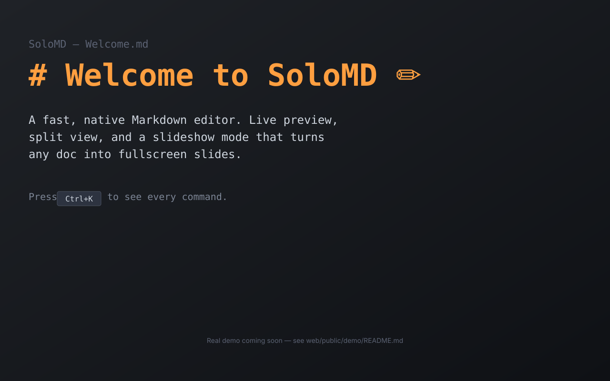
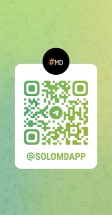

# SoloMD

> The editor where agents live.

[](https://github.com/zhitongblog/solomd/releases/latest)
[](LICENSE)
[](https://github.com/zhitongblog/solomd/releases)
[](https://github.com/zhitongblog/solomd/stargazers)
[](https://atomgit.com/zhitongblog/solomd)
[](https://solomd.app)

🌐 **[中文](README.zh.md) · [日本語](README.ja.md) · [한국어](README.ko.md) · [Deutsch](README.de.md) · [Français](README.fr.md) · [Español](README.es.md) · [Português](README.pt.md) · [Italiano](README.it.md) · [Polski](README.pl.md) · [Nederlands](README.nl.md) · [Türkçe](README.tr.md) · [Svenska](README.sv.md) · [Українська](README.uk.md)** · 🪞 **[AtomGit mirror →](https://atomgit.com/zhitongblog/solomd)** · **[Gitee mirror →](https://gitee.com/zhitong45/solomd)** (faster downloads from China)

[**Download the latest release**](https://github.com/zhitongblog/solomd/releases/latest) · [**AtomGit Releases**](https://atomgit.com/zhitongblog/solomd/releases) · [**Launch post**](https://solomd.app/blog/v4-0-0-agent-native-author/) · [**How we built it**](https://solomd.app/blog/v4-0-0-how-we-built-it/) · [**Website**](https://solomd.app) · [**Security**](https://solomd.app/security)

⭐ **If SoloMD earns a place on your machine, [star it on GitHub](https://github.com/zhitongblog/solomd)** — it's free, made by one developer, and stars are how other people find it.



> ### 🤖 Built and maintained by Claude
>
> SoloMD is written, tested and released almost entirely by **Claude Code**, Anthropic's
> coding agent, working under a human maintainer who sets the direction and decides what
> ships. **Issues and pull requests are triaged and answered by Claude as well** — the
> replies you get here are written by an AI, not typed by a person.
>
> We are telling you this for two reasons. You should know what you are trusting with your
> notes: read the code, it is MIT and all of it is public. And when a reply is confidently
> wrong — it happens — say so in the thread. That correction is the mechanism.
>
> **💼 For Teams & Founders (100% Async Contracts):** Using this exact human-architect + Claude Code pipeline, the maintainer also built **[Unterm](https://unterm.app)** — a self-developed Rust + wgpu terminal kernel exposing 152 MCP methods with an Action Gateway. Available for **100% asynchronous remote contracts** (custom MCP servers, Rust/Tauri agentic desktop apps, and AI workflows — written specs, Loom demos & clean PRs, zero meetings). [**Work with the architect →**](https://doaipm.com/en/about/?utm_source=solomd_readme#work-with-me)

Your notes live in a folder. **SoloMD is the editor on top — with a first-class agent surface inside the editor, and the MCP endpoint Claude Code / Cursor can drive from outside.** Same `.md` files. Chat with your vault. Schedule recipes that run when you're not at the keyboard. Hand the same vault to any MCP client.

Built on Tauri 2 + Vue 3 + CodeMirror 6. Universal macOS dmg ~32 MB. Free, MIT, no subscription, no SoloMD-hosted servers. Your notes, AI keys, embeddings index, and git history all stay on your machine.

## New in 4.6 — the knowledge-graph layer

The structural half Obsidian and Tolaria had and SoloMD didn't — now built, and on SoloMD's own warm design system:

- **Properties inspector** (`⌘⇧I`) — edit YAML frontmatter with type/date/status/relation pickers; line-surgical writes preserve your comments, inline arrays and quoting byte-for-byte.
- **Type-driven sidebar** — give a note `type: Project` and its members become a first-class collapsible section with custom icon/colour/columns (types-as-lenses).
- **Typed relationships** — `belongs_to` / `related_to` / `has` frontmatter with automatic inverses, resolved server-side for big vaults.
- **Relationship graph** ("Neighborhood") — per-note explorer of outgoing + inverse links; click to navigate, ⌘-click to pivot.
- **Saved filtered views** — persistent sidebar views (`.solomd/views/*.yml`) with a recursive all/any filter builder (type / status / date / regex).
- **Inbox workflow** — `⌘E` mark-organized + auto-advance to inbox-zero.
- **tldraw whiteboards** — Markdown-backed boards (` ```tldraw ` fence), cross-compatible with Tolaria's on-disk format, lazy-loaded so the core stays light.

Plus a **unified macOS title bar** (traffic lights inline in the toolbar) and a from-scratch design-system + Vue component library. Still ~15–32 MB, still free, still local-first. → [Compare vs Obsidian / Typora / Tolaria](https://solomd.app/compare)

## Three halves of one product

**The editor.** WYSIWYG live edit (Typora-style), tabs + split panes, KaTeX + Mermaid, image paste to `_assets/`, slideshow mode (`⌘⌥P`), Vim mode, Hunspell + CJK proofread, semantic search (`⌘⇧F`), wikilinks + backlinks, Pandoc export. CJK encodings (GBK / Big5 / Shift-JIS) auto-detected.

**The endpoint.** A bundled `solomd-mcp` binary exposes the same vault to any MCP client — 16 tools out of the box, including SoloMD-only ones (`autogit_log`, `autogit_diff`, `autogit_rollback`, `sync_status`, `share_url`, `read_agent_trace`) that no other markdown server has. v4.0 adds `--workspace path1 --workspace path2` federation — one MCP session, many vaults. Plus a `solomd agent <prompt>` CLI that hands off to Claude Code / Codex CLI with the MCP pre-wired.

**The agent surface (v4.0).** Right-side Agent Panel: streamed chat-with-vault, `[[wikilink]]` citations, tool-call cards inline, **Insert** / **Copy** buttons drop the reply into the active note. Plus declarative **recipes** as YAML in `<workspace>/.solomd/agents/*.yml` — `cron` / `on-save` / `on-commit` / `on-tag-add` / manual triggers. **Every agent write lands on its own AutoGit branch you accept or reject** before it touches `main`; write-cap default 5; refuses to start when the working tree is dirty; replayable `trace.jsonl` per run with `read_agent_trace` MCP tool.

| Feature | |
|---|---|
| **Agent Panel** *(v4.0)* | Streamed chat-with-vault peer to Outline / Backlinks / Tags / History. Tool-call cards expand inline; reply Insert / Copy to active editor; run history persists as plain markdown under `.solomd/agent-runs/`. |
| **Scheduled recipes** *(v4.0)* | YAML jobs in your vault. AutoGit branch sandbox + accept/reject UI before merge. Per-run write-cap (default 5, ceiling 50). 11-recipe cookbook ships in-tree. |
| **Replayable trace** *(v4.0)* | `trace.jsonl` per step (`prompt` / `model_call` / `tool_call` / `tool_result` / `git_commit`). Replay-from-step rewinds and re-executes. |
| **Workspace federation** *(v4.0)* | `solomd-mcp --workspace path1 --workspace path2`. One Claude Desktop session, many vaults. MCP profiles UI in Settings → Integrations. |
| **Ollama first-class** *(v4.0)* | Auto-detect at `localhost:11434`. Three model presets (`qwen2.5:1.5b/7b/14b`). `provider: local` recipe alias for zero-cloud-cost autonomous loops. |
| **AI rewrite, BYOK** | 14 providers — OpenAI · Claude · Gemini · DeepSeek · Qwen · GLM · Kimi · Doubao · SiliconFlow · OpenRouter · Mistral · Groq · xAI · Ollama. Direct vendor calls. Keys in OS keychain. |
| **GitHub-backed sync** | Push your vault to a private GitHub repo on every save. Optional E2EE (Argon2id + XChaCha20-Poly1305). GitLab / Gitea / any HTTPS git URL works too. |
| **AutoGit per note** | Every `⌘S` is a commit in a local `.git` inside the workspace. libgit2 vendored, no system git needed. Never auto-pushed. |
| **MCP server bundled** | `solomd-mcp` ships in the install. 16 tools (see [the list](#mcp-tools)). stdio by default; opt-in Streamable HTTP (`--transport http`, loopback + bearer token). Read-only by default; `--allow-write` opt-in. |
| **REST API** *(v4.0)* | Localhost only, token auth. Same surface as MCP for clients that don't speak MCP yet — Alfred / Raycast / n8n / your own scripts. |
| **BYOK cost meter** *(v4.0)* | Per-provider running tokens-spent counter, opt-in. Settings → Integrations. |
| **Cloud-folder mode** | If your vault lives in `~/Library/Mobile Documents/...` or `~/Dropbox/...`, SoloMD detects it and adds cross-device session restore on top — the OS already does the file sync. |
| **Public read-only share** | Command palette → copy `solomd.app/share/?repo=...&path=...` link. Renders any file in your public GitHub repo, no SoloMD account needed to view. |

## Use it

After installing SoloMD on macOS / Linux:

**1. Chat with your vault.** Open the right-side Agent Panel (⌘⇧P → "View: Toggle Agent Panel" if hidden). Streamed multi-turn against your notes; tool-call cards show every read/write inline. Reply too long? **Insert** drops it into the active note at the cursor (replaces selection); **Copy** to clipboard.

**2. Schedule a recipe.** Settings → Recipes → Browse cookbook. 11 starters ready: weekly review, daily summary, TODO extraction, translation pass, citation cleanup, CJK proofread agent, link-rot detector, frontmatter normalizer, outline-to-blog, refactor pass, weekly tag triage. Install one, edit the prompt, run it.

**3. Drive the same vault from another LLM client.** One-shot (needs the [`solomd` CLI](#command-line-cli)):

```bash
# Print the MCP config snippet for your AI client…
solomd mcp-config
# …or write it straight into every AI client found on this machine.
solomd mcp install
```

```json
{
  "mcpServers": {
    "solomd": {
      "command": "/Applications/SoloMD.app/Contents/MacOS/solomd-mcp",
      "args": ["--workspace", "/Users/me/Documents/SoloMD"]
    }
  }
}
```

Paste into Claude Desktop / Cursor / etc. For multi-vault federation, repeat `--workspace`:

```json
"args": [
  "--workspace", "/Users/me/Documents/SoloMD",
  "--workspace", "/Users/me/Documents/work-notes"
]
```

**4. Or hand a prompt to claude / codex CLI directly:**

```bash
solomd agent "rewrite this week of dailies into a weekly review and commit it"
```

Path-traversal guarded. The LLM only sees what you point the workspace at.

### MCP tools

| Kind | Tools |
|---|---|
| Read (always on) | `list_notes`, `read_note`, `search`, `get_backlinks`, `get_outline`, `list_tags`, `list_tasks`, `autogit_log`, `autogit_diff`, `sync_status`, `share_url`, `read_agent_trace` |
| Write (`--allow-write`) | `write_note`, `append_to_note`, `autogit_rollback`, `export_note` |

`export_note` (html / md / txt / docx) runs the headless exporter with Node.js, so it is only listed when a SoloMD source checkout with `pnpm install` is available (or `SOLOMD_EXPORT_SCRIPT` points at its `app/scripts/solomd-export.mjs`); it never overwrites an existing file unless the call passes `overwrite: true`. Line numbers in every tool count from the top of the file, front matter included.

Transports: stdio (default, what Claude Desktop / Cursor / Cline / Codex use), or Streamable HTTP for hosted clients:

```bash
solomd-mcp --workspace ~/Documents/SoloMD --transport http --bind 127.0.0.1:8765 --auth-token "$TOKEN"
```

HTTP binds to loopback by default; with `--auth-token` (or `SOLOMD_MCP_TOKEN`) every request needs `Authorization: Bearer <token>`. See [`mcp-server/README.md`](mcp-server/README.md).

### Command line (CLI)

`solomd` is a small bash CLI (macOS / Linux) for scripting the vault and wiring up MCP:

```bash
curl -fsSL https://raw.githubusercontent.com/zhitongblog/solomd/main/scripts/install-cli.sh | bash
solomd help
```

`open`, `new`, `list`, `search`, `cat`, `agent`, `mcp list|install|uninstall|config`, `mcp-config`, `--version`; every command takes `-h`. The notes folder is `$SOLOMD_NOTES` (default `~/Documents/SoloMD`). `solomd export` uses the same Node exporter as `export_note`, so it needs a source checkout: run `scripts/solomd` from a clone with `pnpm install` done in `app/`, or set `SOLOMD_EXPORT_SCRIPT`. In the app itself, use File → Export.

## Install

Latest release and every download: [**the releases page**](https://github.com/zhitongblog/solomd/releases/latest).

**System requirements:** Windows 10+, macOS 10.15+, current mainstream Linux, iOS 15+, Android 7+ (API 24).
Windows 7/8/8.1 cannot be supported — the Rust toolchain requires Windows 10 (since Rust 1.78) and Microsoft froze WebView2 (SoloMD's rendering engine) at version 109 on Windows 7 with no security updates — and no legacy build exists.

### macOS — universal dmg (Apple Silicon + Intel, signed + notarized)

```bash
brew install --cask zhitongblog/solomd/solomd
```

Or download the `SoloMD_<version>_universal.dmg` directly from [the releases page](https://github.com/zhitongblog/solomd/releases/latest).

Or one-line shell install:

```bash
curl -fsSL https://solomd.app/install.sh | bash
```

### Windows — x64

- `SoloMD_<version>_x64_en-US.msi`, or `SoloMD_<version>_x64-portable.zip` (no installer), from [the releases page](https://github.com/zhitongblog/solomd/releases/latest)

```powershell
irm https://solomd.app/install.ps1 | iex
```

```powershell
winget install solomd
```

### Linux — x86_64 + aarch64

- `.AppImage` (universal), `.deb` (Debian/Ubuntu), `.rpm` (Fedora/RHEL) — both architectures from [the releases page](https://github.com/zhitongblog/solomd/releases/latest).
- Arch users: [`solomd-bin`](https://aur.archlinux.org/packages/solomd-bin) on AUR.

### iPad

[App Store](https://apps.apple.com/app/solomd/id6762498874) — same engine, native iPad UI.

## Marketplaces & integrations

The bundled `solomd-mcp` server runs against any folder of Markdown files — you don't need to install SoloMD itself to drive your vault from Claude / Cursor / Cline / Continue / Zed. Install snippets for each:

| Client | Config snippet |
|---|---|
| **Claude Desktop** | [`marketplace/client-docs/claude-desktop.md`](marketplace/client-docs/claude-desktop.md) |
| **Claude Code** | [`marketplace/client-docs/claude-code.md`](marketplace/client-docs/claude-code.md) |
| **Cursor** | [`marketplace/client-docs/cursor.md`](marketplace/client-docs/cursor.md) |
| **Cline** (VS Code) | [`marketplace/client-docs/cline.md`](marketplace/client-docs/cline.md) |
| **Continue.dev** | [`marketplace/client-docs/continue.md`](marketplace/client-docs/continue.md) |
| **Zed** | [`marketplace/client-docs/zed.md`](marketplace/client-docs/zed.md) |

Available as:

- **Skill Pack** (`solomd-skills-v<version>.zip` on [the releases page](https://github.com/zhitongblog/solomd/releases/latest)) — 11 reference Agent Recipes (weekly review, todo extract, link suggester, …) you can drop into `<vault>/.solomd/agents/`. Ships with every release.
- **[Claude Code Skill](marketplace/claude-code-skill/)** — `SKILL.md` + `install.sh` that registers `solomd-mcp` as a user-scope MCP server and exposes its 16 tools to Claude Code with patterns and starter recipes.
- **Smithery** — `smithery.yaml` + Dockerfile at [`marketplace/smithery/`](marketplace/smithery/) (submission pending).
- **Awesome MCP Servers** — PR entries for the three biggest community indices (`punkpeye/`, `appcypher/`, `wong2/awesome-mcp-servers`, ~14k forks combined) at [`marketplace/awesome-mcp/`](marketplace/awesome-mcp/).

Full overview + submission status: [`marketplace/README.md`](marketplace/README.md).

## Compared

| | SoloMD v4.5 | Obsidian | Typora | Tolaria |
|---|---|---|---|---|
| License | **MIT** | proprietary (free) | paid ($14.99) | AGPL |
| Stack | Tauri 2 (Rust + WebView) | Electron | Electron | Tauri 2 |
| Platforms | macOS · Win · Linux · **iPad/iOS/Android** | macOS · Win · Linux · iOS · Android | macOS · Win · Linux | macOS · Win · Linux |
| Installer | ~32 MB (mac) / ~10 MB (win) | ~120 MB | ~95 MB | ~25 MB |
| **Inline Agent Panel** | **✅ v4.0** | 🟡 paid plugins (Smart Composer / Copilot) | ❌ | 🟡 providers + agents, no inline panel |
| **Scheduled agent recipes** | **✅ v4.0** | ❌ | ❌ | ❌ |
| **AutoGit branch sandbox + accept/reject** | **✅ v4.0** | ❌ | ❌ | ❌ |
| **Replayable agent trace** | **✅ v4.0** | ❌ | ❌ | ❌ |
| **Multi-workspace** | **✅ v4.0 MCP federation** | ❌ | ❌ | 🟡 multi-vault |
| **MCP server bundled** | **✅ 16 tools, 6 SoloMD-only** | ❌ (community plugins) | ❌ | ✅ generic |
| **Built-in AI rewrite** | **✅ 14 BYOK providers** | plugin only | ❌ | ✅ built-in providers |
| GitHub-backed sync | ✅ | ❌ (Obsidian Sync $5/mo) | ❌ | ❌ |
| End-to-end encryption | ✅ on your repo | ✅ on Obsidian's servers | ❌ | ❌ |
| Local RAG / semantic search | ✅ off by default | plugin only | ❌ | ❌ |
| Version history per note | ✅ AutoGit | plugin only | ❌ | ✅ |
| Markdown whiteboards (tldraw) | ❌ | 🟡 Canvas (own format) | ❌ | ✅ |
| CJK encodings (GBK / Big5) | ✅ auto-detect | ❌ | ❌ | ❌ |

Detailed breakdowns: [vs Obsidian](https://solomd.app/compare/vs-obsidian) · [vs Typora](https://solomd.app/compare/vs-typora) · [vs Tolaria](https://solomd.app/compare/vs-tolaria) · [vs Marktext](https://solomd.app/compare/vs-marktext).

## Privacy & security

Pure client-side. Your `.md` files stay in the folder you chose. API keys live in the OS keychain (macOS Keychain / Windows Credential Manager / Linux libsecret), never in `localStorage` or any config file. AI requests go direct from your machine to the provider you picked — no SoloMD relay. RAG embeddings and the AutoGit repo are local-only. The MCP server speaks stdio by default; its optional HTTP transport binds to loopback unless you choose otherwise, and can require a bearer token. The whole codebase is MIT and auditable.

**Agent safety rails (v4.0).** Every recipe run starts on its own AutoGit branch — your `main` stays untouched until you click Accept on the diff. Per-run write-cap (default 5, hard ceiling 50) prevents runaway loops. Recipe runner refuses to start when the working tree is dirty (no agent commit will ever sweep your work-in-progress). Path-traversal guards reject `..` segments and absolute paths upfront in every Tauri / MCP / REST endpoint that accepts a user-supplied path.

E2EE sync uses Argon2id (RFC9106 default params) → XChaCha20-Poly1305 with deterministic nonces and path-as-AAD. Plaintext stays on your devices; the remote sees only ciphertext. Failed `sync.json` parsing is fail-closed — refuses to push rather than degrading to plaintext (a v3.0.x audit fix).

Full writeup: <https://solomd.app/security>.

## Build from source

Prereqs: Rust (stable), Node 18+, pnpm.

```bash
git clone https://github.com/zhitongblog/solomd.git
cd solomd/app
pnpm install
pnpm tauri dev      # dev with hot reload
pnpm tauri build    # release artifacts → src-tauri/target/release/bundle/
```

Linux additionally needs `libdbus-1-dev` for the keychain backend.

The MCP server is a separate crate at `mcp-server/`; the dev MCP harness used for end-to-end testing lives at `dev-mcp/`. End-to-end test entry point: `scripts/v4-self-test.sh` (run with `--with-release --with-ollama --with-ui` for full coverage).

## Contributing

Issues and PRs welcome — [open one](https://github.com/zhitongblog/solomd/issues). For a sense of direction, see [`docs/roadmap.md`](docs/roadmap.md). The v4.0 build log is at [solomd.app/blog/v4-0-0-how-we-built-it/](https://solomd.app/blog/v4-0-0-how-we-built-it/) — start there if you want to understand the engineering principles before sending a PR.

## Contact / 联系

One maintainer, two front doors. Async on [GitHub Discussions](https://github.com/zhitongblog/solomd/discussions). Real-time chat:

- **Telegram (international):** [@SOLOMDAPP](https://t.me/SOLOMDAPP) — release announcements + chat
- **WeChat (中文):** scan to add me — note "SoloMD" 注明 SoloMD 直接通过

<a href="https://solomd.app/#contact"></a>
&nbsp;&nbsp;
<a href="https://t.me/SOLOMDAPP"></a>

<!-- sponsors:start -->
## Sponsors

Thank you to everyone who sponsors SoloMD: **tyysoft(太阳雨)**

*(Note: This is a partial opt-in list — WeChat Pay, Alipay, and App Store / Google Play in-app tips are anonymous by default. If you supported SoloMD and would like your name listed, please open an issue or see [solomd.app/thanks](https://solomd.app/thanks).)*
<!-- sponsors:end -->

> **✨ 100% Free Forever & Supporter Badge:** Every feature in SoloMD is 100% free forever — no paywalls, no subscriptions, no ads. To support independent open-source development, you can sponsor via [GitHub Sponsors](https://github.com/sponsors/zhitongblog) / [PayPal / Alipay / WeChat Pay](https://solomd.app/#sponsor), or use the 3 optional one-time in-app tip tiers on **Mac App Store, iOS App Store, and Google Play** (`☕ Buy a Coffee $0.99` · `🍜 Buy a Lunch $2.99` · `🚀 Generous Support $9.99`) to permanently unlock the exclusive **`✨ Supporter`** badge in Settings and About.

<!-- ALL-CONTRIBUTORS-LIST:START - generated by scripts/update-sponsors-readme.py -->
## Contributors

Thank you to everyone who helps make SoloMD better — sponsors 💵, testers 🐛🤔, code/theme/packaging contributors 💻🎨📦 and promoters 📣 ([All Contributors](https://allcontributors.org) spec). Full wall of thanks: [solomd.app/thanks](https://solomd.app/thanks) · Promote SoloMD: [solomd.app/promote](https://solomd.app/promote)

<table>
  <tbody>
    <tr><td align="center" valign="top" width="14.28%"><a href="https://github.com/tyysoft"><br /><sub><b>tyysoft(太阳雨)</b></sub></a><br /><a href="https://solomd.app/thanks" title="Financial">💵</a> <a href="https://solomd.app/thanks" title="Bug reports">🐛</a> <a href="https://solomd.app/thanks" title="Ideas">🤔</a></td><td align="center" valign="top" width="14.28%"><a href="https://solomd.app/thanks"><sub><b>张工</b></sub></a><br /><a href="https://solomd.app/thanks" title="Bug reports">🐛</a> <a href="https://solomd.app/thanks" title="Ideas">🤔</a></td><td align="center" valign="top" width="14.28%"><a href="https://solomd.app/thanks"><sub><b>冰瞬若风</b></sub></a><br /><a href="https://solomd.app/thanks" title="Bug reports">🐛</a> <a href="https://solomd.app/thanks" title="Ideas">🤔</a></td><td align="center" valign="top" width="14.28%"><a href="https://github.com/lcfactorization"><br /><sub><b>lcfactorization</b></sub></a><br /><a href="https://solomd.app/thanks" title="Bug reports">🐛</a> <a href="https://solomd.app/thanks" title="Ideas">🤔</a> <a href="https://blog.csdn.net/stereohomology/article/details/167864282" title="Promotion">📣</a></td><td align="center" valign="top" width="14.28%"><a href="https://github.com/ScienceZone"><br /><sub><b>ScienceZone</b></sub></a><br /><a href="https://solomd.app/thanks" title="Bug reports">🐛</a> <a href="https://solomd.app/thanks" title="Ideas">🤔</a></td><td align="center" valign="top" width="14.28%"><a href="https://github.com/Limoncello-Zoey"><br /><sub><b>Limoncello-Zoey</b></sub></a><br /><a href="https://solomd.app/thanks" title="Bug reports">🐛</a> <a href="https://solomd.app/thanks" title="Ideas">🤔</a></td><td align="center" valign="top" width="14.28%"><a href="https://github.com/davi-jorge-art"><br /><sub><b>davi-jorge-art</b></sub></a><br /><a href="https://solomd.app/thanks" title="Bug reports">🐛</a> <a href="https://solomd.app/thanks" title="Ideas">🤔</a></td></tr>
    <tr><td align="center" valign="top" width="14.28%"><a href="https://github.com/zhuhaisto"><br /><sub><b>zhuhaisto</b></sub></a><br /><a href="https://solomd.app/thanks" title="Bug reports">🐛</a> <a href="https://solomd.app/thanks" title="Ideas">🤔</a></td><td align="center" valign="top" width="14.28%"><a href="https://github.com/licryle"><br /><sub><b>licryle</b></sub></a><br /><a href="https://solomd.app/thanks" title="Bug reports">🐛</a> <a href="https://solomd.app/thanks" title="Ideas">🤔</a></td><td align="center" valign="top" width="14.28%"><a href="https://github.com/ed-edwin"><br /><sub><b>ed-edwin</b></sub></a><br /><a href="https://solomd.app/thanks" title="Bug reports">🐛</a> <a href="https://solomd.app/thanks" title="Ideas">🤔</a></td><td align="center" valign="top" width="14.28%"><a href="https://github.com/xjfnet"><br /><sub><b>xjfnet</b></sub></a><br /><a href="https://solomd.app/thanks" title="Bug reports">🐛</a> <a href="https://solomd.app/thanks" title="Ideas">🤔</a></td><td align="center" valign="top" width="14.28%"><a href="https://github.com/Snowboy801"><br /><sub><b>Snowboy801</b></sub></a><br /><a href="https://solomd.app/thanks" title="Bug reports">🐛</a> <a href="https://solomd.app/thanks" title="Ideas">🤔</a></td><td align="center" valign="top" width="14.28%"><a href="https://github.com/chenghaitao"><br /><sub><b>chenghaitao</b></sub></a><br /><a href="https://solomd.app/thanks" title="Code">💻</a></td><td align="center" valign="top" width="14.28%"><a href="https://github.com/beihai23"><br /><sub><b>Lance.Wang (beihai23)</b></sub></a><br /><a href="https://solomd.app/thanks" title="Code">💻</a></td></tr>
    <tr><td align="center" valign="top" width="14.28%"><a href="https://github.com/jukejeew"><br /><sub><b>JukeJeew (jukejeew)</b></sub></a><br /><a href="https://solomd.app/thanks" title="Code">💻</a></td><td align="center" valign="top" width="14.28%"><a href="https://github.com/DarkModest"><br /><sub><b>DarkModest</b></sub></a><br /><a href="https://solomd.app/thanks" title="Code">💻</a></td><td align="center" valign="top" width="14.28%"><a href="https://github.com/raopan2021"><br /><sub><b>SYMF (raopan2021)</b></sub></a><br /><a href="https://solomd.app/thanks" title="Theme & Design">🎨</a></td><td align="center" valign="top" width="14.28%"><a href="https://github.com/fengzhoujingshui"><br /><sub><b>LiRui (fengzhoujingshui)</b></sub></a><br /><a href="https://solomd.app/thanks" title="Code">💻</a></td><td align="center" valign="top" width="14.28%"><a href="https://github.com/octo-patch"><br /><sub><b>Octopus (octo-patch)</b></sub></a><br /><a href="https://solomd.app/thanks" title="Code">💻</a></td><td align="center" valign="top" width="14.28%"><a href="https://github.com/guangtoutong"><br /><sub><b>guangtoutong</b></sub></a><br /><a href="https://solomd.app/thanks" title="Code">💻</a></td><td align="center" valign="top" width="14.28%"><a href="https://github.com/gregoreficint"><br /><sub><b>SmartKeyerror (gregoreficint)</b></sub></a><br /><a href="https://solomd.app/thanks" title="Code">💻</a></td></tr>
    <tr><td align="center" valign="top" width="14.28%"><a href="https://github.com/xu-qian123"><br /><sub><b>sakura777 (xu-qian123)</b></sub></a><br /><a href="https://solomd.app/thanks" title="Theme & Design">🎨</a></td><td align="center" valign="top" width="14.28%"><a href="https://github.com/lizhen789"><br /><sub><b>Sherri Gutmann (lizhen789)</b></sub></a><br /><a href="https://solomd.app/thanks" title="Code">💻</a></td><td align="center" valign="top" width="14.28%"><a href="https://github.com/vishalhabib99"><br /><sub><b>Vishal Habib (vishalhabib99)</b></sub></a><br /><a href="https://solomd.app/thanks" title="Code">💻</a></td><td align="center" valign="top" width="14.28%"><a href="https://github.com/bcronje"><br /><sub><b>Beyers Cronje (bcronje)</b></sub></a><br /><a href="https://solomd.app/thanks" title="Code">💻</a></td><td align="center" valign="top" width="14.28%"><a href="https://github.com/Zxis233"><br /><sub><b>Esing (Zxis233)</b></sub></a><br /><a href="https://solomd.app/thanks" title="Code">💻</a></td><td align="center" valign="top" width="14.28%"><a href="https://github.com/yzcj105"><br /><sub><b>Jing Chen (yzcj105)</b></sub></a><br /><a href="https://solomd.app/thanks" title="Code">💻</a></td><td align="center" valign="top" width="14.28%"><a href="https://github.com/ZHTodd223"><br /><sub><b>ZHTodd223</b></sub></a><br /><a href="https://solomd.app/thanks" title="Code">💻</a></td></tr>
    <tr><td align="center" valign="top" width="14.28%"><a href="https://github.com/JumpingY"><br /><sub><b>JumpingY (zhangpingyang)</b></sub></a><br /><a href="https://solomd.app/thanks" title="Code">💻</a></td><td align="center" valign="top" width="14.28%"><a href="https://github.com/gonwe"><br /><sub><b>gonwe</b></sub></a><br /><a href="https://solomd.app/thanks" title="Packaging">📦</a></td><td align="center" valign="top" width="14.28%"><a href="https://github.com/jysz"><br /><sub><b>jysz</b></sub></a><br /><a href="https://solomd.app/thanks" title="Packaging">📦</a></td><td align="center" valign="top" width="14.28%"><a href="https://store.linyaps.org.cn/apps/app.solomd?arch=x86_64"><sub><b>^9星守辰^</b></sub></a><br /><a href="https://solomd.app/thanks" title="Packaging">📦</a> <a href="https://store.linyaps.org.cn/apps/app.solomd?arch=x86_64" title="Promotion">📣</a></td><td align="center" valign="top" width="14.28%"><a href="https://github.com/Howard-Zhou-77"><br /><sub><b>Howard-Zhou-77</b></sub></a><br /><a href="https://solomd.app/thanks" title="Code">💻</a></td><td align="center" valign="top" width="14.28%"><a href="https://github.com/shobhitagnihotri69"><br /><sub><b>shobhitagnihotri69</b></sub></a><br /><a href="https://solomd.app/thanks" title="Code">💻</a></td><td align="center" valign="top" width="14.28%"><a href="https://github.com/zx0r"><br /><sub><b>zx0r</b></sub></a><br /><a href="https://solomd.app/thanks" title="Packaging">📦</a></td></tr>
    <tr><td align="center" valign="top" width="14.28%"><a href="https://github.com/Thibaultjaigu"><br /><sub><b>Thibaultjaigu</b></sub></a><br /><a href="https://solomd.app/thanks" title="Code">💻</a></td><td align="center" valign="top" width="14.28%"><a href="https://github.com/aiapienthusiast"><br /><sub><b>aiapienthusiast</b></sub></a><br /><a href="https://solomd.app/thanks" title="Code">💻</a></td><td align="center" valign="top" width="14.28%"><a href="https://github.com/heydryft"><br /><sub><b>heydryft</b></sub></a><br /><a href="https://solomd.app/thanks" title="Code">💻</a></td><td align="center" valign="top" width="14.28%"><a href="https://github.com/PioneerSunOvO"><br /><sub><b>Garfield</b></sub></a><br /><a href="https://x.com/Garfield_OxO/status/2110654220894343301" title="Promotion">📣</a></td></tr>
  </tbody>
</table>
<!-- ALL-CONTRIBUTORS-LIST:END -->

## License & credits

[MIT](LICENSE) © 2026 xiangdong li. SoloMD stands on Tauri 2, Vue 3, CodeMirror 6, markdown-it, KaTeX, Mermaid, libgit2, Pandoc, Hunspell, `keyring-rs`, and `rmcp`. Sponsor on [GitHub Sponsors](https://github.com/sponsors/zhitongblog) or via [solomd.app/#sponsor](https://solomd.app/#sponsor).

### Open-source hosting & G-Star Program

<p>
  <a href="https://atomgit.com/zhitongblog/solomd" target="_blank" rel="noopener">
    <picture>
      <source media="(prefers-color-scheme: dark)" srcset="https://docs.atomgit.com/img/logo-AtomGit-dark.svg" />
      
    </picture>
  </a>
</p>

Special thanks to **[AtomGit (G-Star Program)](https://atomgit.com/zhitongblog/solomd)** for hosting SoloMD's official mirror and release packages in mainland China.
