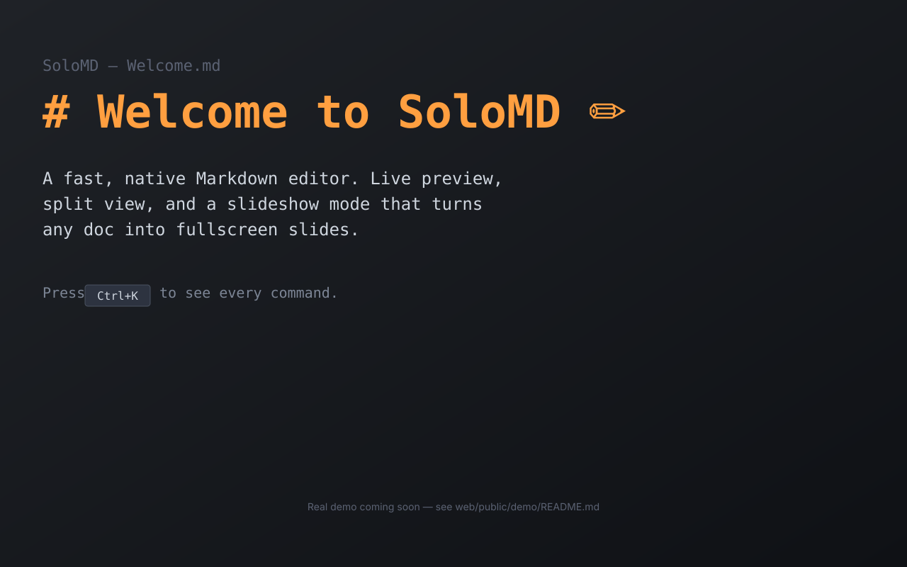
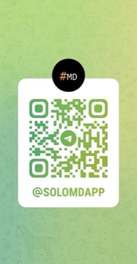

# SoloMD

> 让 Agent 住进来的编辑器。

[](https://github.com/zhitongblog/solomd/releases/latest)
[](LICENSE)
[](https://github.com/zhitongblog/solomd/releases)
[](https://github.com/zhitongblog/solomd/stargazers)
[](https://atomgit.com/zhitongblog/solomd)
[](https://solomd.app/zh)
[](https://atomgit.com/zhitongblog/solomd)
[](https://gitee.com/zhitong45/solomd)

🌐 **[English](README.md) · [日本語](README.ja.md) · [한국어](README.ko.md) · [Deutsch](README.de.md) · [Français](README.fr.md) · [Español](README.es.md) · [Português](README.pt.md) · [Italiano](README.it.md) · [Polski](README.pl.md) · [Nederlands](README.nl.md) · [Türkçe](README.tr.md) · [Svenska](README.sv.md) · [Українська](README.uk.md)**

[**下载最新版**](https://github.com/zhitongblog/solomd/releases/latest) · [**AtomGit 国内高速下载**](https://atomgit.com/zhitongblog/solomd/releases) · [**Gitee 镜像下载**](https://gitee.com/zhitong45/solomd/releases) · [**v4.0 发布说明**](https://solomd.app/zh/blog/v4-0-0-agent-native-author/) · [**官网**](https://solomd.app/zh) · [**安全说明**](https://solomd.app/zh/security)

⭐ **如果 SoloMD 值得留在你的电脑上，请[去 GitHub 点个 Star](https://github.com/zhitongblog/solomd)** —— 免费开源、一个人维护，Star 能让更多人发现它。



> ### 🤖 由 Claude 开发与维护
>
> SoloMD 的代码、测试和发版几乎全部由 Anthropic 的编码智能体 **Claude Code** 完成，
> 由一位人类维护者把握方向、决定发什么。**issue 和 PR 也是由 Claude 处理和回复的**
> —— 你在这里收到的回复是 AI 写的，不是人一个字一个字敲的。
>
> 说明这件事有两个理由。你有权知道自己把笔记交给了什么：代码是 MIT 的，全部公开，
> 欢迎自己读。另外，当回复信誓旦旦却是错的时候——这确实会发生——请直接在帖子里指出来，
> 纠正机制就是这个。
>
> **💼 面向团队与创始人（100% 异步远程架构合作）：** 用同一套「人类架构师 + Claude Code」流水线，维护者还独立构建了 **[Unterm](https://unterm.app)**（自研 Rust + wgpu 终端内核，暴露 152 个 MCP 方法与 Action Gateway 风险分级网关）。承接海内外 **100% 纯异步远程合同**（定制 MCP Server、Rust/Tauri 原生 Agent 桌面应用与自动化工程 —— 书面规格 + 演示视频 + 生产级 PR，零冗长会议）。[**查看架构作品集与合作方式 →**](https://doaipm.com/zh/about/?utm_source=solomd_readme#work-with-me)

你的笔记是一个文件夹。**SoloMD 既是上面的编辑器、内置一等公民的 Agent 面板，也是 Claude Code / Cursor 直接能从外部驱动的 MCP 端点。** 同样的 `.md` 文件。在编辑器里跟你的 vault 对话；定时跑 recipe 不用守在键盘前；同一个 vault 还能交给任何 MCP 客户端。

基于 Tauri 2 + Vue 3 + CodeMirror 6 构建。Mac universal dmg ~32 MB。免费 / MIT / 无订阅 / 无 SoloMD 服务器。笔记、AI key、嵌入索引、git 历史，全部留在你自己的机器上。

## 同一份产品的三半

**编辑器。** WYSIWYG 实时编辑（Typora 风格）、标签 + 分屏、KaTeX + Mermaid 数学公式、图片粘贴到 `_assets/`、演讲模式（`⌘⌥P`）、Vim 模式、Hunspell + 中文校对、语义搜索（`⌘⇧F`）、wikilink + 反链、Pandoc 导出。CJK 编码（GBK / Big5 / Shift-JIS）自动识别。

**端点。** 自带 `solomd-mcp` 二进制,把同一个 vault 暴露给任意 MCP 客户端 —— 开箱 16 个工具,其中 6 个 SoloMD 独有(`autogit_log`、`autogit_diff`、`autogit_rollback`、`sync_status`、`share_url`、`read_agent_trace`),别家 markdown MCP 服务都没有。v4.0 加了 `--workspace path1 --workspace path2` federation —— 一个 MCP 会话,多个 vault。再加一个 `solomd agent <prompt>` 命令行,把任务直接交给 Claude Code / Codex CLI,MCP 已预先连好。

**Agent 面板（v4.0）。** 右侧一等公民 Agent 面板：流式 chat-with-vault、`[[wikilink]]` 引用解析为真笔记跳转、工具调用卡片在对话流里展开、**插入** / **复制** 按钮把回复塞回当前编辑器。同时支持声明式 **Recipe** —— YAML 文件放在 `<workspace>/.solomd/agents/*.yml`,触发器 `cron` / `on-save` / `on-commit` / `on-tag-add` / 手动。**每次 Agent 写入都落到独立 AutoGit 分支上,你点 Accept 才合入 `main`**;单次 write-cap 默认 5;工作区脏时拒绝启动;每次运行生成可重放的 `trace.jsonl`,新增 `read_agent_trace` MCP 工具暴露给其他 agent。

| 功能 | |
|---|---|
| **Agent 面板** *(v4.0)* | 流式 chat-with-vault,跟大纲 / 反向链接 / 标签 / 历史平级。工具调用卡片在对话流里展开;回复"插入" / "复制"到当前编辑器;运行历史以 markdown 形式存在 `.solomd/agent-runs/`。 |
| **定时 Recipe** *(v4.0)* | YAML 文件放在 vault 里。AutoGit 分支沙箱 + accept/reject UI 评审后再合 main。单次 write-cap(默认 5,硬上限 50)。自带 11 个起步模板。 |
| **可重放 Trace** *(v4.0)* | 按步 `trace.jsonl`(`prompt` / `model_call` / `tool_call` / `tool_result` / `git_commit`)。"从第 N 步重放"按钮回退后重新跑。 |
| **多 vault MCP Federation** *(v4.0)* | `solomd-mcp --workspace path1 --workspace path2`。一个 Claude Desktop 会话,多个 vault。设置 → 集成里有 MCP profile UI。 |
| **Ollama 一等公民** *(v4.0)* | 自动检测 `localhost:11434`。三个模型预设(`qwen2.5:1.5b/7b/14b`)。Recipe 用 `provider: local` 跑零云成本自动循环。 |
| **AI 改写,BYOK** | 14 个服务 —— OpenAI · Claude · Gemini · DeepSeek · 通义千问 · 智谱 GLM · Kimi · 豆包 · 硅基流动 · OpenRouter · Mistral · Groq · xAI · Ollama。Key 存在系统钥匙串里,直连厂商,不经我们手。 |
| **GitHub 同步** | 每次保存推到自己的 GitHub 私库,定时拉取。可选端到端加密(Argon2id + XChaCha20-Poly1305)。GitLab / Gitea / 任意 HTTPS git 地址也支持。 |
| **每篇笔记 AutoGit** | 每次 `⌘S` 在工作区里的本地 `.git` 写一次提交。libgit2 内嵌,不需要装系统 git。永不自动 push。 |
| **内置 MCP server** | `solomd-mcp` 跟随安装包发出,16 个工具。默认走 stdio;可选 Streamable HTTP(`--transport http`,默认只监听本机,可要求 Bearer token)。默认只读,`--allow-write` 显式开启写入。 |
| **本地 REST API** *(v4.0)* | 只监听 localhost,token 鉴权。和 MCP 同一套接口,给那些还没接 MCP 的客户端用 —— Alfred / Raycast / n8n / 你自己的脚本。 |
| **BYOK 成本计** *(v4.0)* | 按 provider 累计 token 数,opt-in。设置 → 集成。 |
| **云盘联动** | 工作区在 `~/Library/Mobile Documents/...` 或 `~/Dropbox/...` 里时,SoloMD 自动识别,并在此之上加一层跨设备会话恢复 —— 文件级同步交给系统。 |
| **公开只读分享** | 命令面板 → 复制 `solomd.app/share/?repo=...&path=...` 链接。任何人在浏览器里就能阅读你公库里这篇笔记,不用装 SoloMD。 |

## 怎么用

macOS / Linux 装好 SoloMD 后:

**1. 跟你的 vault 对话。** 打开右侧 Agent 面板(⌘⇧P → "View: Toggle Agent Panel" 如果隐藏了)。流式多轮 chat,工具调用卡片实时显示每次读写。回复太长?**插入**按钮把回复塞到当前笔记的光标处(有选区就替换);**复制**进剪贴板。

**2. 定时跑 Recipe。** 设置 → Recipes → 浏览菜谱。11 个起步模板:周报、日报、TODO 抽取、翻译过一遍、引用清理、CJK 校对 agent、链接腐烂检测、front-matter 规范化、大纲转博客、重构过一遍、周度 tag 整理。安装、改 prompt、运行。

**3. 从外部 LLM 客户端驱动同一个 vault。** 一键打印 MCP 配置:

```bash
solomd mcp-config
```

```json
{
  "mcpServers": {
    "solomd": {
      "command": "/Applications/SoloMD.app/Contents/MacOS/solomd-mcp",
      "args": ["--workspace", "/Users/me/Documents/SoloMD"]
    }
  }
}
```

粘到 Claude Desktop / Cursor / 等。多 vault federation 重复 `--workspace`:

```json
"args": [
  "--workspace", "/Users/me/Documents/SoloMD",
  "--workspace", "/Users/me/Documents/work-notes"
]
```

**4. 或者一句话直接交给 claude / codex CLI:**

```bash
solomd agent "把这周的 daily 整理成 weekly review，提交并推送"
```

路径穿越保护已加。LLM 只能看到你指给它的工作区。

## 安装

最新版本:[**v4.0.0**](https://github.com/zhitongblog/solomd/releases/latest)。

**系统要求:**Windows 10+、macOS 10.15+、主流 Linux 发行版、iOS 15+、Android 7+(API 24)。
Windows 7/8/8.1 无法支持——编译 SoloMD 的 Rust 工具链自 1.78 起要求 Windows 10,且微软已将 Windows 7 上的 WebView2(SoloMD 的渲染引擎)冻结在 109 版并停止安全更新——也不存在可用的历史版本。

### macOS — universal dmg(Apple Silicon + Intel,已签名 + 公证)

```bash
brew install --cask zhitongblog/solomd/solomd
```

或直接下 dmg:

```
https://github.com/zhitongblog/solomd/releases/latest/download/SoloMD_4.0.0_universal.dmg
```

或 curl 一键安装:

```bash
curl -fsSL https://solomd.app/install.sh | bash
```

### Windows — x64

- [`SoloMD_4.0.0_x64_en-US.msi`](https://github.com/zhitongblog/solomd/releases/latest/download/SoloMD_4.0.0_x64_en-US.msi)
- [`SoloMD_4.0.0_x64-setup.exe`](https://github.com/zhitongblog/solomd/releases/latest/download/SoloMD_4.0.0_x64-setup.exe)(NSIS)
- [`SoloMD_4.0.0_x64-portable.zip`](https://github.com/zhitongblog/solomd/releases/latest/download/SoloMD_4.0.0_x64-portable.zip) — 免安装版

```powershell
irm https://solomd.app/install.ps1 | iex
```

```powershell
winget install solomd
```

### Linux — x86_64 + aarch64

- `.AppImage`(通用)、`.deb`(Debian/Ubuntu)、`.rpm`(Fedora/RHEL)—— 两种架构都在 [发布页](https://github.com/zhitongblog/solomd/releases/latest)。
- Arch 用户:[`solomd-bin`](https://aur.archlinux.org/packages/solomd-bin)(AUR)。

### iPad

[App Store](https://apps.apple.com/app/solomd/id6762498874) —— 同一引擎,原生 iPad UI。

## 横向对比

| | SoloMD v4.5 | Obsidian | Typora | Tolaria |
|---|---|---|---|---|
| 协议 | **MIT** | 私有协议(免费) | 付费($14.99) | AGPL |
| 技术栈 | Tauri 2(Rust + WebView) | Electron | Electron | Tauri 2 |
| 平台 | macOS · Win · Linux · **iPad/iOS/安卓** | macOS · Win · Linux · iOS · Android | macOS · Win · Linux | macOS · Win · Linux |
| 安装包 | ~32 MB(Mac)/ ~10 MB(Win) | ~120 MB | ~95 MB | ~25 MB |
| **内置 Agent 面板** | **✅ v4.0** | 🟡 付费插件(Smart Composer / Copilot) | ❌ | 🟡 provider+agent,无内嵌面板 |
| **定时 Agent Recipe** | **✅ v4.0** | ❌ | ❌ | ❌ |
| **AutoGit 分支沙箱 + accept/reject** | **✅ v4.0** | ❌ | ❌ | ❌ |
| **可重放 Agent Trace** | **✅ v4.0** | ❌ | ❌ | ❌ |
| **多工作区** | **✅ v4.0 MCP Federation** | ❌ | ❌ | 🟡 多 vault |
| **MCP server** | **✅ 内置 16 工具,6 个独家** | ❌(社区插件) | ❌ | ✅ 通用 |
| **AI 改写内建** | **✅ 14 个 BYOK 服务** | 仅插件 | ❌ | ✅ 内置 provider |
| GitHub 同步 | ✅ | ❌(Obsidian Sync $5/月) | ❌ | ❌ |
| 端到端加密 | ✅ 在你自己的库里 | ✅ 在 Obsidian 服务器上 | ❌ | ❌ |
| 本地语义搜索 | ✅ 默认关 | 仅插件 | ❌ | ❌ |
| 每篇笔记版本历史 | ✅ AutoGit | 仅插件 | ❌ | ✅ |
| Markdown 白板(tldraw) | ❌ | 🟡 Canvas(私有格式) | ❌ | ✅ |
| CJK 编码(GBK / Big5) | ✅ 自动识别 | ❌ | ❌ | ❌ |

详细对比:[vs Obsidian](https://solomd.app/zh/compare/vs-obsidian) · [vs Typora](https://solomd.app/zh/compare/vs-typora) · [vs Tolaria](https://solomd.app/zh/compare/vs-tolaria) · [vs Marktext](https://solomd.app/zh/compare/vs-marktext)。

## 隐私与安全

纯客户端。你的 `.md` 文件留在你选的文件夹里。API key 存在系统钥匙串(macOS Keychain / Windows Credential Manager / Linux libsecret),**永远不进 localStorage 或配置文件**。AI 请求从你的机器直连厂商 —— 不经 SoloMD 中转。RAG 嵌入索引和 AutoGit 仓库都是本地。MCP server 默认走 stdio;可选的 HTTP 传输默认只监听本机,并可要求 Bearer token。整个代码库 MIT 协议,可审计。

**Agent 安全护栏(v4.0)。** 每次 Recipe 运行都开自己的 AutoGit 分支 —— `main` 在你点 Accept 之前一动不动。单次 write-cap(默认 5,硬上限 50)防止失控循环。Recipe runner 在工作区脏时直接拒绝启动(agent commit 不会扫到你的 WIP)。所有接受用户传入路径的 Tauri / MCP / REST 端点都前置拒绝 `..` 段和绝对路径。

E2EE 同步用 Argon2id(RFC9106 默认参数)→ XChaCha20-Poly1305,确定性 nonce + path-as-AAD。明文留在你的设备上;远端只看到密文。`sync.json` 解析失败会**拒绝推送**,绝不降级到明文(v3.0.x 审计修过的一条)。

完整说明:<https://solomd.app/zh/security>。

## 从源码编译

依赖:Rust(stable)、Node 18+、pnpm。

```bash
git clone https://github.com/zhitongblog/solomd.git
cd solomd/app
pnpm install
pnpm tauri dev      # 热重载开发
pnpm tauri build    # 打 release 包 → src-tauri/target/release/bundle/
```

Linux 还需要 `libdbus-1-dev` 用于钥匙串后端。

MCP server 是独立 crate,在 `mcp-server/` 目录;端到端测试用的 dev MCP harness 在 `dev-mcp/`。端到端测试入口:`scripts/v4-self-test.sh`(用 `--with-release --with-ollama --with-ui` 跑全量)。

## 贡献

欢迎 Issue / PR —— [开一个](https://github.com/zhitongblog/solomd/issues)。方向参考 [`docs/roadmap.md`](docs/roadmap.md)。v4.0 的工程笔记在 [solomd.app/blog/v4-0-0-how-we-built-it/](https://solomd.app/blog/v4-0-0-how-we-built-it/) —— 想理解工程原则后再 PR,从这里开始。

## 联系

一个维护者,两个入口。异步:[GitHub Discussions](https://github.com/zhitongblog/solomd/discussions)。即时:

- **Telegram(国际):** [@SOLOMDAPP](https://t.me/SOLOMDAPP) — 发版通知 + 闲聊
- **微信(中文):** 扫码加我,备注 "SoloMD"

<a href="https://solomd.app/#contact"></a>
&nbsp;&nbsp;
<a href="https://t.me/SOLOMDAPP"></a>

<!-- sponsors:start -->
## 赞助者

感谢这些朋友对 SoloMD 的赞助：**tyysoft(太阳雨)**

*（注：此处仅展示主动登记署名的部分赞助者——微信/支付宝扫码打赏及 App Store / Google Play 应用内支持者徽章默认匿名。若您曾打赏支持并希望留名，欢迎随时通过 Issue 告知，完整名单见 [solomd.app/zh/thanks](https://solomd.app/zh/thanks)。）*
<!-- sponsors:end -->

> **✨ 100% 永久免费与「支持者」徽章：** SoloMD 所有核心功能 100% 永久免费、无广告、无订阅墙。如果你想支持独立开源开发，除了通过 [GitHub Sponsors](https://github.com/sponsors/zhitongblog) 或 [官网支付宝 / 微信 / PayPal](https://solomd.app/zh/#sponsor) 赞助外，在 **Mac App Store、iOS App Store 与 Google Play** 版本中还可通过「设置 / 关于 → 支持 SoloMD」选择三档一次性自愿打赏（`☕ 请喝杯咖啡 ¥8/$0.99` · `🍜 请吃顿工作餐 ¥28/$2.99` · `🚀 强力支持 ¥68/$9.99`），并在应用内永久点亮专属 **「✨ 支持者」** 徽章。

<!-- ALL-CONTRIBUTORS-LIST:START - generated by scripts/update-sponsors-readme.py -->
## 贡献者

感谢每一位让 SoloMD 变得更好的朋友——赞助者 💵、深度测试者 🐛🤔、代码/主题/打包贡献者 💻🎨📦 和推广者 📣（按 [All Contributors](https://allcontributors.org) 规范）。完整鸣谢名单：[solomd.app/zh/thanks](https://solomd.app/zh/thanks) · 成为推广者：[solomd.app/zh/promote](https://solomd.app/zh/promote)

<table>
  <tbody>
    <tr><td align="center" valign="top" width="14.28%"><a href="https://github.com/tyysoft"><br /><sub><b>tyysoft(太阳雨)</b></sub></a><br /><a href="https://solomd.app/thanks" title="Financial">💵</a> <a href="https://solomd.app/thanks" title="Bug reports">🐛</a> <a href="https://solomd.app/thanks" title="Ideas">🤔</a></td><td align="center" valign="top" width="14.28%"><a href="https://solomd.app/thanks"><sub><b>张工</b></sub></a><br /><a href="https://solomd.app/thanks" title="Bug reports">🐛</a> <a href="https://solomd.app/thanks" title="Ideas">🤔</a></td><td align="center" valign="top" width="14.28%"><a href="https://solomd.app/thanks"><sub><b>冰瞬若风</b></sub></a><br /><a href="https://solomd.app/thanks" title="Bug reports">🐛</a> <a href="https://solomd.app/thanks" title="Ideas">🤔</a></td><td align="center" valign="top" width="14.28%"><a href="https://github.com/lcfactorization"><br /><sub><b>lcfactorization</b></sub></a><br /><a href="https://solomd.app/thanks" title="Bug reports">🐛</a> <a href="https://solomd.app/thanks" title="Ideas">🤔</a> <a href="https://blog.csdn.net/stereohomology/article/details/167864282" title="Promotion">📣</a></td><td align="center" valign="top" width="14.28%"><a href="https://github.com/ScienceZone"><br /><sub><b>ScienceZone</b></sub></a><br /><a href="https://solomd.app/thanks" title="Bug reports">🐛</a> <a href="https://solomd.app/thanks" title="Ideas">🤔</a></td><td align="center" valign="top" width="14.28%"><a href="https://github.com/Limoncello-Zoey"><br /><sub><b>Limoncello-Zoey</b></sub></a><br /><a href="https://solomd.app/thanks" title="Bug reports">🐛</a> <a href="https://solomd.app/thanks" title="Ideas">🤔</a></td><td align="center" valign="top" width="14.28%"><a href="https://github.com/davi-jorge-art"><br /><sub><b>davi-jorge-art</b></sub></a><br /><a href="https://solomd.app/thanks" title="Bug reports">🐛</a> <a href="https://solomd.app/thanks" title="Ideas">🤔</a></td></tr>
    <tr><td align="center" valign="top" width="14.28%"><a href="https://github.com/zhuhaisto"><br /><sub><b>zhuhaisto</b></sub></a><br /><a href="https://solomd.app/thanks" title="Bug reports">🐛</a> <a href="https://solomd.app/thanks" title="Ideas">🤔</a></td><td align="center" valign="top" width="14.28%"><a href="https://github.com/licryle"><br /><sub><b>licryle</b></sub></a><br /><a href="https://solomd.app/thanks" title="Bug reports">🐛</a> <a href="https://solomd.app/thanks" title="Ideas">🤔</a></td><td align="center" valign="top" width="14.28%"><a href="https://github.com/ed-edwin"><br /><sub><b>ed-edwin</b></sub></a><br /><a href="https://solomd.app/thanks" title="Bug reports">🐛</a> <a href="https://solomd.app/thanks" title="Ideas">🤔</a></td><td align="center" valign="top" width="14.28%"><a href="https://github.com/xjfnet"><br /><sub><b>xjfnet</b></sub></a><br /><a href="https://solomd.app/thanks" title="Bug reports">🐛</a> <a href="https://solomd.app/thanks" title="Ideas">🤔</a></td><td align="center" valign="top" width="14.28%"><a href="https://github.com/Snowboy801"><br /><sub><b>Snowboy801</b></sub></a><br /><a href="https://solomd.app/thanks" title="Bug reports">🐛</a> <a href="https://solomd.app/thanks" title="Ideas">🤔</a></td><td align="center" valign="top" width="14.28%"><a href="https://github.com/chenghaitao"><br /><sub><b>chenghaitao</b></sub></a><br /><a href="https://solomd.app/thanks" title="Code">💻</a></td><td align="center" valign="top" width="14.28%"><a href="https://github.com/beihai23"><br /><sub><b>Lance.Wang (beihai23)</b></sub></a><br /><a href="https://solomd.app/thanks" title="Code">💻</a></td></tr>
    <tr><td align="center" valign="top" width="14.28%"><a href="https://github.com/jukejeew"><br /><sub><b>JukeJeew (jukejeew)</b></sub></a><br /><a href="https://solomd.app/thanks" title="Code">💻</a></td><td align="center" valign="top" width="14.28%"><a href="https://github.com/DarkModest"><br /><sub><b>DarkModest</b></sub></a><br /><a href="https://solomd.app/thanks" title="Code">💻</a></td><td align="center" valign="top" width="14.28%"><a href="https://github.com/raopan2021"><br /><sub><b>SYMF (raopan2021)</b></sub></a><br /><a href="https://solomd.app/thanks" title="Theme & Design">🎨</a></td><td align="center" valign="top" width="14.28%"><a href="https://github.com/fengzhoujingshui"><br /><sub><b>LiRui (fengzhoujingshui)</b></sub></a><br /><a href="https://solomd.app/thanks" title="Code">💻</a></td><td align="center" valign="top" width="14.28%"><a href="https://github.com/octo-patch"><br /><sub><b>Octopus (octo-patch)</b></sub></a><br /><a href="https://solomd.app/thanks" title="Code">💻</a></td><td align="center" valign="top" width="14.28%"><a href="https://github.com/guangtoutong"><br /><sub><b>guangtoutong</b></sub></a><br /><a href="https://solomd.app/thanks" title="Code">💻</a></td><td align="center" valign="top" width="14.28%"><a href="https://github.com/gregoreficint"><br /><sub><b>SmartKeyerror (gregoreficint)</b></sub></a><br /><a href="https://solomd.app/thanks" title="Code">💻</a></td></tr>
    <tr><td align="center" valign="top" width="14.28%"><a href="https://github.com/xu-qian123"><br /><sub><b>sakura777 (xu-qian123)</b></sub></a><br /><a href="https://solomd.app/thanks" title="Theme & Design">🎨</a></td><td align="center" valign="top" width="14.28%"><a href="https://github.com/lizhen789"><br /><sub><b>Sherri Gutmann (lizhen789)</b></sub></a><br /><a href="https://solomd.app/thanks" title="Code">💻</a></td><td align="center" valign="top" width="14.28%"><a href="https://github.com/vishalhabib99"><br /><sub><b>Vishal Habib (vishalhabib99)</b></sub></a><br /><a href="https://solomd.app/thanks" title="Code">💻</a></td><td align="center" valign="top" width="14.28%"><a href="https://github.com/bcronje"><br /><sub><b>Beyers Cronje (bcronje)</b></sub></a><br /><a href="https://solomd.app/thanks" title="Code">💻</a></td><td align="center" valign="top" width="14.28%"><a href="https://github.com/Zxis233"><br /><sub><b>Esing (Zxis233)</b></sub></a><br /><a href="https://solomd.app/thanks" title="Code">💻</a></td><td align="center" valign="top" width="14.28%"><a href="https://github.com/yzcj105"><br /><sub><b>Jing Chen (yzcj105)</b></sub></a><br /><a href="https://solomd.app/thanks" title="Code">💻</a></td><td align="center" valign="top" width="14.28%"><a href="https://github.com/ZHTodd223"><br /><sub><b>ZHTodd223</b></sub></a><br /><a href="https://solomd.app/thanks" title="Code">💻</a></td></tr>
    <tr><td align="center" valign="top" width="14.28%"><a href="https://github.com/JumpingY"><br /><sub><b>JumpingY (zhangpingyang)</b></sub></a><br /><a href="https://solomd.app/thanks" title="Code">💻</a></td><td align="center" valign="top" width="14.28%"><a href="https://github.com/gonwe"><br /><sub><b>gonwe</b></sub></a><br /><a href="https://solomd.app/thanks" title="Packaging">📦</a></td><td align="center" valign="top" width="14.28%"><a href="https://github.com/jysz"><br /><sub><b>jysz</b></sub></a><br /><a href="https://solomd.app/thanks" title="Packaging">📦</a></td><td align="center" valign="top" width="14.28%"><a href="https://store.linyaps.org.cn/apps/app.solomd?arch=x86_64"><sub><b>^9星守辰^</b></sub></a><br /><a href="https://solomd.app/thanks" title="Packaging">📦</a> <a href="https://store.linyaps.org.cn/apps/app.solomd?arch=x86_64" title="Promotion">📣</a></td><td align="center" valign="top" width="14.28%"><a href="https://github.com/Howard-Zhou-77"><br /><sub><b>Howard-Zhou-77</b></sub></a><br /><a href="https://solomd.app/thanks" title="Code">💻</a></td><td align="center" valign="top" width="14.28%"><a href="https://github.com/shobhitagnihotri69"><br /><sub><b>shobhitagnihotri69</b></sub></a><br /><a href="https://solomd.app/thanks" title="Code">💻</a></td><td align="center" valign="top" width="14.28%"><a href="https://github.com/zx0r"><br /><sub><b>zx0r</b></sub></a><br /><a href="https://solomd.app/thanks" title="Packaging">📦</a></td></tr>
    <tr><td align="center" valign="top" width="14.28%"><a href="https://github.com/Thibaultjaigu"><br /><sub><b>Thibaultjaigu</b></sub></a><br /><a href="https://solomd.app/thanks" title="Code">💻</a></td><td align="center" valign="top" width="14.28%"><a href="https://github.com/aiapienthusiast"><br /><sub><b>aiapienthusiast</b></sub></a><br /><a href="https://solomd.app/thanks" title="Code">💻</a></td><td align="center" valign="top" width="14.28%"><a href="https://github.com/heydryft"><br /><sub><b>heydryft</b></sub></a><br /><a href="https://solomd.app/thanks" title="Code">💻</a></td><td align="center" valign="top" width="14.28%"><a href="https://github.com/PioneerSunOvO"><br /><sub><b>Garfield</b></sub></a><br /><a href="https://x.com/Garfield_OxO/status/2110654220894343301" title="Promotion">📣</a></td></tr>
  </tbody>
</table>
<!-- ALL-CONTRIBUTORS-LIST:END -->

## License & 致谢

[MIT](LICENSE) © 2026 xiangdong li。SoloMD 站在 Tauri 2、Vue 3、CodeMirror 6、markdown-it、KaTeX、Mermaid、libgit2、Pandoc、Hunspell、`keyring-rs` 和 `rmcp` 的肩膀上。赞助:[GitHub Sponsors](https://github.com/sponsors/zhitongblog) 或 [solomd.app/#sponsor](https://solomd.app/#sponsor)。

### 开源托管与 G-Star 计划支持

<p>
  <a href="https://atomgit.com/zhitongblog/solomd" target="_blank" rel="noopener">
    <picture>
      <source media="(prefers-color-scheme: dark)" srcset="https://docs.atomgit.com/img/logo-AtomGit-dark.svg" />
      
    </picture>
  </a>
</p>

感谢 **[AtomGit（开源摘星计划 G-Star）](https://atomgit.com/zhitongblog/solomd)** 为 SoloMD 提供国内代码托管与 Release 高速分发支持。