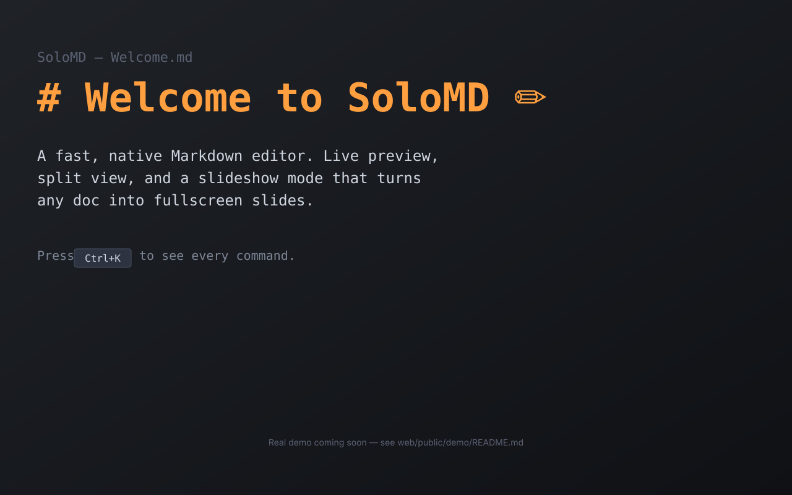

# SoloMD

> 不止于 Typora 的安静手感 —— 五端免费同步、9 格式直出导出与本地 AI 的开源 Markdown 知识库。

[](https://github.com/zhitongblog/solomd/releases/latest)
[](LICENSE)
[](https://github.com/zhitongblog/solomd/releases)
[](https://github.com/zhitongblog/solomd/stargazers)
[](https://atomgit.com/zhitongblog/solomd)
[](https://solomd.app/zh)
[](https://atomgit.com/zhitongblog/solomd)
[](https://gitee.com/zhitong45/solomd)

🌐 **[English](README.md) · [日本語](README.ja.md) · [한국어](README.ko.md) · [Deutsch](README.de.md) · [Français](README.fr.md) · [Español](README.es.md) · [Português](README.pt.md) · [Italiano](README.it.md) · [Polski](README.pl.md) · [Nederlands](README.nl.md) · [Türkçe](README.tr.md) · [Svenska](README.sv.md) · [Українська](README.uk.md)**

[**下载 v5.2.0 最新版**](https://github.com/zhitongblog/solomd/releases/latest) · [**AtomGit 国内高速下载**](https://atomgit.com/zhitongblog/solomd/releases/tag/v5.2.0) · [**Gitee 镜像下载**](https://gitee.com/zhitong45/solomd/releases/tag/v5.2.0) · [**v5.2 新特性**](https://solomd.app/zh/whats-new/) · [**对比 Obsidian & Typora**](https://solomd.app/zh/compare/) · [**官网**](https://solomd.app/zh) · [**安全说明**](https://solomd.app/zh/security)

⭐ **如果 SoloMD 值得留在你的电脑上，请[去 GitHub 点个 Star](https://github.com/zhitongblog/solomd)** —— 免费开源、一个人维护，Star 能让更多人发现它。



> ### 🤖 由 Claude 开发与维护
>
> SoloMD 的代码、测试和发版几乎全部由 Anthropic 的编码智能体 **Claude Code** 完成，
> 由一位人类维护者把握方向、决定发什么。**issue 和 PR 也是由 Claude 处理和回复的**
> —— 你在这里收到的回复是 AI 写的，不是人一个字一个字敲的。
>
> 说明这件事有两个理由。你有权知道自己把笔记交给了什么：代码是 MIT 的，全部公开，
> 欢迎自己读。另外，当回复信誓旦旦却是错的时候——这确实会发生——请直接在帖子里指出来，
> 纠正机制就是这个。
>
> **💼 面向团队与创始人（100% 异步远程架构合作）：** 用同一套「人类架构师 + Claude Code」流水线，维护者还独立构建了 **[Unterm](https://unterm.app)**（自研 Rust + wgpu 终端内核，暴露 152 个 MCP 方法与 Action Gateway 风险分级网关）。承接海内外 **100% 纯异步远程合同**（定制 MCP Server、Rust/Tauri 原生 Agent 桌面应用与自动化工程 —— 书面规格 + 演示视频 + 生产级 PR，零冗长会议）。[**查看架构作品集与合作方式 →**](https://doaipm.com/zh/about/?utm_source=solomd_readme#work-with-me)

你的笔记依然是一个普通的本地文件夹。**SoloMD 同时给你 Typora 般安静居中的写作手感、Obsidian 式的本地双链知识库、不收月租的五端加密同步、开箱直出的 9 格式导出中心，以及零配置本地 AI 与 16 工具 MCP 服务。**

基于 Tauri 2 + Vue 3 + CodeMirror 6 + Rust 构建。Windows 安装包约 14 MB、Linux (`.deb`/`.rpm`) 约 16 MB、Android (`arm64`) 约 21 MB、macOS 双架构通用包 (`Universal .dmg`) 约 30 MB。MIT 开源、无账号、无订阅、无插件税、无 SoloMD 中转服务器。你的笔记、API 密钥、语义嵌入索引与 Git 历史全部留在你自己的设备上。

## v5.0 – v5.2 核心升级

- **三种无感编辑模式 (`v5.2`)** —— 在 **纯正所见即所得**（即使光标所在行也彻底隐藏 Markdown 语法符号，杜绝跳行闪烁）、**实时预览**（仅当前行展开语法）与 **源码 / 分屏同步** 之间随时切换。
- **统一 9 格式导出中心 (`v5.2`)** —— 带实时预览的统一导出面板，开箱直出 **PDF**（含 KaTeX 公式与 Mermaid 图表）、**Word (`.docx`)**、**HTML**、**EPUB**、**LaTeX**、**ODT**、**RTF**、**纯文本** 与 **Markdown** —— **无需手动折腾安装 Pandoc**。
- **零配置本地 AI (OPR) + 20+ 家 BYOK 服务商 (`v5.2`)** —— 一键 Open Provider Registry (OPR) 自动探测本机正在运行的 **Ollama**、**LM Studio**、**Jan**、**vLLM** 与 **llama.cpp** 服务；或填入 DeepSeek、通义千问、智谱 GLM、Kimi、豆包、MiniMax、硅基流动、Claude、OpenAI、Gemini、Groq、OpenRouter 等 20+ 家厂商密钥（安全存储于系统钥匙串）。
- **按知识库隔离的加密云盘与 Git 同步 (`v5.2`)** —— 每个工作区文件夹可独立绑定 **iCloud Drive**、**OneDrive**、**坚果云**、**百度网盘**、**阿里云盘**、**Syncthing**、**WebDAV**、**S3 / Cloudflare R2** 或 **GitHub / Gitee / GitLab**，支持可选的 **AES-256-GCM / XChaCha20-Poly1305** 端到端加密与冲突副本保护。
- **轻量级声明式 JSON 扩展 (`v5.2`)** —— 只需在 `<workspace>/.solomd/plugins/*.json` 放入简单的 JSON 文件（或在「设置 → 扩展」中管理），即可扩展自定义 `/` 斜杠模板、命令面板正则/模板文本转换与一键 Webhook 发布。
- **CLI v2 与 16 工具 MCP 服务 (`v5.2`)** —— 终端命令 `solomd open / new / daily / list / search / export / agent / mcp`，搭配支持多知识库 Federation 的 `solomd-mcp`。

## 一款轻量原生应用里的三大支柱

1. **纯粹写作与出版。** 纯正所见即所得 + 实时预览 + 分屏视图、选中悬浮格式条、焦点模式 + 打字机模式、全屏幻灯片演讲模式（`⌘⌥P`）、Vim 模式、KaTeX 数学公式 + Mermaid 图表、截图粘贴自动存入 `_assets/`、内置 9 格式导出中心，以及拖入 `.docx / .pdf / .xlsx / .pptx` 直接转为 Markdown。中文一等公民：自动编码识别（UTF-8 / GBK / Big5 / Shift-JIS）、CJK 精准字数统计与 OpenCC 简繁转换。
2. **五端同步的本地双链知识库。** 原生覆盖 **macOS、Windows（x64 + ARM64）、Linux（x64 + ARM64）、iOS/iPadOS 与 Android**，支持跨设备标签页会话恢复。内置 `[[双链]]`、反向链接、YAML 属性面板、100% 离线运行的本地语义搜索（`⌘⇧F`）、每次 `⌘S` 自动提交的 AutoGit 版本历史（内置 libgit2），以及按知识库隔离的免费加密同步。
3. **本地 AI 与 MCP 接口。** 选中文字 `⌘J` 行内改写/翻译/总结、右侧智能体面板（流式与整个知识库对话、`[[双链]]` 引用跳转、一键插入当前笔记）、OPR 本地模型自动探测 + 20+ BYOK，以及随包附带的 `solomd-mcp`（16 个工具直连 Claude Desktop、Cursor、Windsurf、Claude Code）。

| 功能 | 说明 |
|---|---|
| **三种编辑模式** *(v5.2)* | **纯正所见即所得**（光标所在行不跳出语法标记）、**实时预览**、**源码 / 分屏同步**。 |
| **统一 9 格式导出中心** *(v5.2)* | 内置实时预览，一键导出 PDF、Word (.docx)、HTML、EPUB、LaTeX、ODT、RTF、TXT、MD —— 无需配置外部 Pandoc。 |
| **按知识库隔离的云同步** *(v5.2)* | 每个知识库独立绑定 iCloud、OneDrive、坚果云、百度/阿里云盘、Syncthing、WebDAV、S3/R2 或 GitHub/Gitee/GitLab，支持端到端加密。 |
| **OPR 本地 AI + 20+ BYOK** *(v5.2)* | 一键发现本机 Ollama / LM Studio / Jan / vLLM / llama.cpp，或直连 20+ 家云端大模型。密钥存于系统钥匙串。 |
| **轻量 JSON 用户扩展** *(v5.2)* | `.solomd/plugins/*.json` 声明式扩展自定义 `/斜杠` 模板、正则/模板转换器与一键 Webhook 发布。 |
| **智能体面板与行内 AI 改写** | 流式与知识库对话（带 `[[双链]]` 引用与一键插入/复制），以及 `⌘J` 选中文字即时改写润色。 |
| **内置 16 工具 MCP Server** | `solomd-mcp` 随安装包附带，支持 `--workspace path1 --workspace path2` 多知识库 Federation，默认 stdio，可选本机 HTTP。 |
| **每篇笔记 AutoGit 快照** | 每次 `⌘S` 自动在工作区本地 `.git` 写入提交（内置 libgit2，无需安装系统 git）。侧栏可视化对比 diff 并一键回滚。 |
| **完全离线语义搜索 (RAG)** | `⌘⇧F` 按语义含义检索全库段落，Rust 进程内原生嵌入 —— 零模型下载、零网络请求。 |

## 怎么用

**1. 写作、双链与导出。** 打开任意 `.md` 文件夹。在顶栏一键切换「纯正所见即所得 / 实时预览 / 分屏」；按 `⌘⇧E`（或「文件 → 导出」）打开统一 9 格式导出中心。

**2. 行内改写或与知识库对话。** 选中文字按 `⌘J` 即可用 AI 润色/翻译/续写；或打开右侧智能体面板（`⌘⇧P` → *View: Toggle Agent Panel*）针对整个知识库多轮提问。在「设置 → AI」中点击 **自动发现本地模型** 即可一键连上本机 Ollama / LM Studio。

**3. 从 Claude Desktop / Cursor / Claude Code 驱动同一个知识库：**

```bash
# 打印 MCP 配置片段…
solomd mcp-config
# …或一键自动写入本机已安装的 AI 客户端：
solomd mcp install
```

```json
{
  "mcpServers": {
    "solomd": {
      "command": "/Applications/SoloMD.app/Contents/MacOS/solomd-mcp",
      "args": ["--workspace", "/Users/me/Documents/SoloMD"]
    }
  }
}
```

多知识库 Federation 只需重复 `--workspace`：

```json
"args": [
  "--workspace", "/Users/me/Documents/SoloMD",
  "--workspace", "/Users/me/Documents/work-notes"
]
```

**4. 或者在终端一句话交给 `claude` / `codex` CLI：**

```bash
solomd agent "把这周的 daily 笔记整理成周报并提交"
```

## 安装

最新版本：[**v5.2.0（GitHub Releases）**](https://github.com/zhitongblog/solomd/releases/latest) · [**AtomGit 国内高速镜像**](https://atomgit.com/zhitongblog/solomd/releases/tag/v5.2.0) · [**Gitee 国内镜像**](https://gitee.com/zhitong45/solomd/releases/tag/v5.2.0)。

**系统要求：** Windows 10+、macOS 10.15+、主流 Linux 发行版、iOS 15+、Android 7+ (API 24)。

### macOS — universal dmg（Apple Silicon + Intel，已签名 + 公证）

```bash
brew install --cask zhitongblog/solomd/solomd
```

或一行命令安装：

```bash
curl -fsSL https://solomd.app/install.sh | bash
```

或直接下载：[`SoloMD_5.2.0_universal.dmg`](https://github.com/zhitongblog/solomd/releases/download/v5.2.0/SoloMD_5.2.0_universal.dmg) · [Mac App Store](https://apps.apple.com/app/solomd/id6762498874)

### Windows — x64 & ARM64

- [`SoloMD_5.2.0_x64_en-US.msi`](https://github.com/zhitongblog/solomd/releases/download/v5.2.0/SoloMD_5.2.0_x64_en-US.msi) / [`SoloMD_5.2.0_arm64_en-US.msi`](https://github.com/zhitongblog/solomd/releases/download/v5.2.0/SoloMD_5.2.0_arm64_en-US.msi)
- [`SoloMD_5.2.0_x64-portable.zip`](https://github.com/zhitongblog/solomd/releases/download/v5.2.0/SoloMD_5.2.0_x64-portable.zip) — 免安装便携版

```powershell
irm https://solomd.app/install.ps1 | iex
```

```powershell
winget install solomd
```

### Linux — x86_64 + aarch64

- `.AppImage`（通用）、`.deb`（Debian/Ubuntu）、`.rpm`（Fedora/RHEL）—— 两种架构均在 [发布页](https://github.com/zhitongblog/solomd/releases/latest)。
- Arch 用户：[`solomd-bin`](https://aur.archlinux.org/packages/solomd-bin) (AUR)。

### iPhone / iPad 与 Android

- **iOS / iPadOS：** [App Store](https://apps.apple.com/app/solomd/id6762498874)
- **Android：** [Google Play](https://play.google.com/store/apps/details?id=app.solomd) 或直接下载 [`SoloMD_5.2.0_universal.apk`](https://github.com/zhitongblog/solomd/releases/download/v5.2.0/SoloMD_5.2.0_universal.apk)

## 横向对比

| | SoloMD v5.2 | Obsidian | Typora | MarkText |
|---|---|---|---|---|
| 协议 | **MIT 开源** | 闭源专有（免费） | 闭源付费（$14.99） | MIT（2023 年起停更） |
| 技术栈 | Tauri 2（Rust + 系统原生 WebView） | Electron | Electron | Electron |
| 平台 | **macOS · Win · Linux · iOS · Android** | macOS · Win · Linux · iOS · Android | 仅桌面端 | 仅桌面端 |
| 安装包 | **~14 MB (Win) / ~16 MB (Linux) / ~30 MB (Mac 通用包)** | ~110 MB | ~70 MB | ~80 MB |
| **纯正所见即所得 + 实时预览 + 分屏** | **✅ 三种模式全齐** | 🟡 仅实时预览 | ✅ | ✅ |
| **内置 9 格式直出导出（免装 Pandoc）** | **✅ v5.2** | 🟡 仅 PDF（其余靠插件） | 🟡 需自行安装 Pandoc | ❌ |
| **按知识库隔离的免费云盘与 Git 同步** | **✅ iCloud / OneDrive / 坚果云 / WebDAV / S3 / Git** | ❌（官方同步 $96/年） | ❌ | ❌ |
| **端到端加密** | **✅ 加密存于你自己的网盘/仓库** | ✅ 仅限付费官方同步 | ❌ | ❌ |
| **零配置本地 AI（OPR 自动探测）** | **✅ Ollama / LM Studio / Jan / vLLM** | 🟡 需第三方插件 | ❌ | ❌ |
| **内置 BYOK AI 服务商** | **✅ 20+ 家（密钥存系统钥匙串）** | 🟡 单插件仅 1–2 家 | ❌ | ❌ |
| **内置 MCP Server** | **✅ 16 工具 + 多知识库 Federation** | ❌（需社区插件） | ❌ | ❌ |
| **轻量级声明式 JSON 扩展** | **✅ `.solomd/plugins/*.json`** | ✅ 重型 JS 插件 | ❌ | ❌ |
| **本地离线语义搜索 (RAG)** | **✅ Rust 原生内嵌** | 🟡 需第三方插件 | ❌ | ❌ |
| **每篇笔记自动版本历史** | **✅ AutoGit（内置 libgit2）** | 🟡 需手动配 git 插件 | ❌ | ❌ |
| **中文编码 (GBK / Big5) + 简繁转换** | **✅ 自动识别** | ❌ | ❌ | ❌ |

详细对比：[vs Obsidian](https://solomd.app/zh/compare/vs-obsidian) · [vs Typora](https://solomd.app/zh/compare/vs-typora) · [vs Tolaria](https://solomd.app/zh/compare/vs-tolaria) · [vs MarkText](https://solomd.app/zh/compare/vs-marktext)。

## 隐私与安全

纯客户端架构。你的 `.md` 文件留在你选择的本地文件夹中。API 密钥保存在操作系统钥匙串（macOS Keychain / Windows Credential Manager / Linux libsecret），**绝不写入 `localStorage` 或明文配置文件**。AI 请求从你的设备直连你选择的厂商或本机模型 —— 不经过任何 SoloMD 服务器中转。语义搜索嵌入索引与 AutoGit 仓库全部在本地运行。MCP server 默认走 stdio；可选的 HTTP 传输默认仅监听本机回环地址并支持 Bearer token 鉴权。全部源码基于 MIT 协议公开可审计。

端到端加密同步采用 AES-256-GCM（网盘 `.solomd-enc` 同步）与 Argon2id → XChaCha20-Poly1305（Git/远端同步）。明文永远留在你的设备上，远端只存储密文。所有接受路径参数的 Tauri 与 MCP 接口均内置路径穿越防护。

完整说明：<https://solomd.app/zh/security>。

## 从源码编译

依赖:Rust(stable)、Node 18+、pnpm。

```bash
git clone https://github.com/zhitongblog/solomd.git
cd solomd/app
pnpm install
pnpm tauri dev      # 热重载开发
pnpm tauri build    # 打 release 包 → src-tauri/target/release/bundle/
```

Linux 还需要 `libdbus-1-dev` 用于钥匙串后端。

MCP server 是独立 crate,在 `mcp-server/` 目录;端到端测试用的 dev MCP harness 在 `dev-mcp/`。端到端测试入口:`scripts/v4-self-test.sh`(用 `--with-release --with-ollama --with-ui` 跑全量)。

## 贡献

欢迎 Issue / PR —— [开一个](https://github.com/zhitongblog/solomd/issues)。方向参考 [`docs/roadmap.md`](docs/roadmap.md)。v4.0 的工程笔记在 [solomd.app/blog/v4-0-0-how-we-built-it/](https://solomd.app/blog/v4-0-0-how-we-built-it/) —— 想理解工程原则后再 PR,从这里开始。

## 联系

一个维护者,两个入口。异步:[GitHub Discussions](https://github.com/zhitongblog/solomd/discussions)。即时:

- **Telegram(国际):** [@SOLOMDAPP](https://t.me/SOLOMDAPP) — 发版通知 + 闲聊
- **微信(中文):** 扫码加我,备注 "SoloMD"

<a href="https://solomd.app/#contact"></a>
&nbsp;&nbsp;
<a href="https://t.me/SOLOMDAPP"></a>

<!-- sponsors:start -->
## 赞助者

感谢这些朋友对 SoloMD 的赞助：**tyysoft(太阳雨)** · **m*p** · ***和**

*（注：此处仅展示主动登记署名的部分赞助者——微信/支付宝扫码打赏及 App Store / Google Play 应用内支持者徽章默认匿名。若您曾打赏支持并希望留名，欢迎随时通过 Issue 告知，完整名单见 [solomd.app/zh/thanks](https://solomd.app/zh/thanks)。）*
<!-- sponsors:end -->

> **✨ 100% 永久免费与「支持者」徽章：** SoloMD 所有核心功能 100% 永久免费、无广告、无订阅墙。如果你想支持独立开源开发，除了通过 [GitHub Sponsors](https://github.com/sponsors/zhitongblog) 或 [官网支付宝 / 微信 / PayPal](https://solomd.app/zh/#sponsor) 赞助外，在 **Mac App Store、iOS App Store 与 Google Play** 版本中还可通过「设置 / 关于 → 支持 SoloMD」选择三档一次性自愿打赏（`☕ 请喝杯咖啡 ¥8/$0.99` · `🍜 请吃顿工作餐 ¥28/$2.99` · `🚀 强力支持 ¥68/$9.99`），并在应用内永久点亮专属 **「✨ 支持者」** 徽章。

<!-- ALL-CONTRIBUTORS-LIST:START - generated by scripts/update-sponsors-readme.py -->
## 贡献者

感谢每一位让 SoloMD 变得更好的朋友——赞助者 💵、深度测试者 🐛🤔、代码/主题/打包贡献者 💻🎨📦 和推广者 📣（按 [All Contributors](https://allcontributors.org) 规范）。完整鸣谢名单：[solomd.app/zh/thanks](https://solomd.app/zh/thanks) · 成为推广者：[solomd.app/zh/promote](https://solomd.app/zh/promote)

<table>
  <tbody>
    <tr><td align="center" valign="top" width="14.28%"><a href="https://github.com/tyysoft"><br /><sub><b>tyysoft(太阳雨)</b></sub></a><br /><a href="https://solomd.app/thanks" title="Financial">💵</a> <a href="https://solomd.app/thanks" title="Bug reports">🐛</a> <a href="https://solomd.app/thanks" title="Ideas">🤔</a> <a href="https://tyysoft.blog.csdn.net/article/details/170355638" title="Promotion">📣</a> <a href="https://www.cnblogs.com/tyysoft/p/23603038" title="Promotion">📣</a></td><td align="center" valign="top" width="14.28%"><a href="https://solomd.app/thanks"><sub><b>m*p</b></sub></a><br /><a href="https://solomd.app/thanks" title="Financial">💵</a></td><td align="center" valign="top" width="14.28%"><a href="https://solomd.app/thanks"><sub><b>*和</b></sub></a><br /><a href="https://solomd.app/thanks" title="Financial">💵</a></td><td align="center" valign="top" width="14.28%"><a href="https://solomd.app/thanks"><sub><b>张工</b></sub></a><br /><a href="https://solomd.app/thanks" title="Bug reports">🐛</a> <a href="https://solomd.app/thanks" title="Ideas">🤔</a></td><td align="center" valign="top" width="14.28%"><a href="https://solomd.app/thanks"><sub><b>冰瞬若风</b></sub></a><br /><a href="https://solomd.app/thanks" title="Bug reports">🐛</a> <a href="https://solomd.app/thanks" title="Ideas">🤔</a></td><td align="center" valign="top" width="14.28%"><a href="https://github.com/lcfactorization"><br /><sub><b>lcfactorization</b></sub></a><br /><a href="https://solomd.app/thanks" title="Bug reports">🐛</a> <a href="https://solomd.app/thanks" title="Ideas">🤔</a> <a href="https://blog.csdn.net/stereohomology/article/details/167864282" title="Promotion">📣</a></td><td align="center" valign="top" width="14.28%"><a href="https://github.com/ScienceZone"><br /><sub><b>ScienceZone</b></sub></a><br /><a href="https://solomd.app/thanks" title="Bug reports">🐛</a> <a href="https://solomd.app/thanks" title="Ideas">🤔</a></td></tr>
    <tr><td align="center" valign="top" width="14.28%"><a href="https://github.com/Limoncello-Zoey"><br /><sub><b>Limoncello-Zoey</b></sub></a><br /><a href="https://solomd.app/thanks" title="Bug reports">🐛</a> <a href="https://solomd.app/thanks" title="Ideas">🤔</a></td><td align="center" valign="top" width="14.28%"><a href="https://github.com/davi-jorge-art"><br /><sub><b>davi-jorge-art</b></sub></a><br /><a href="https://solomd.app/thanks" title="Bug reports">🐛</a> <a href="https://solomd.app/thanks" title="Ideas">🤔</a></td><td align="center" valign="top" width="14.28%"><a href="https://github.com/zhuhaisto"><br /><sub><b>zhuhaisto</b></sub></a><br /><a href="https://solomd.app/thanks" title="Bug reports">🐛</a> <a href="https://solomd.app/thanks" title="Ideas">🤔</a></td><td align="center" valign="top" width="14.28%"><a href="https://github.com/licryle"><br /><sub><b>licryle</b></sub></a><br /><a href="https://solomd.app/thanks" title="Bug reports">🐛</a> <a href="https://solomd.app/thanks" title="Ideas">🤔</a></td><td align="center" valign="top" width="14.28%"><a href="https://github.com/ed-edwin"><br /><sub><b>ed-edwin</b></sub></a><br /><a href="https://solomd.app/thanks" title="Bug reports">🐛</a> <a href="https://solomd.app/thanks" title="Ideas">🤔</a></td><td align="center" valign="top" width="14.28%"><a href="https://github.com/xjfnet"><br /><sub><b>xjfnet</b></sub></a><br /><a href="https://solomd.app/thanks" title="Bug reports">🐛</a> <a href="https://solomd.app/thanks" title="Ideas">🤔</a></td><td align="center" valign="top" width="14.28%"><a href="https://github.com/Snowboy801"><br /><sub><b>Snowboy801</b></sub></a><br /><a href="https://solomd.app/thanks" title="Bug reports">🐛</a> <a href="https://solomd.app/thanks" title="Ideas">🤔</a></td></tr>
    <tr><td align="center" valign="top" width="14.28%"><a href="https://github.com/nickzengxl"><br /><sub><b>nickzengxl</b></sub></a><br /><a href="https://solomd.app/thanks" title="Bug reports">🐛</a> <a href="https://solomd.app/thanks" title="Ideas">🤔</a></td><td align="center" valign="top" width="14.28%"><a href="https://github.com/Howard-Zhou-77"><br /><sub><b>Howard-Zhou-77</b></sub></a><br /><a href="https://solomd.app/thanks" title="Bug reports">🐛</a> <a href="https://solomd.app/thanks" title="Ideas">🤔</a> <a href="https://solomd.app/thanks" title="Code">💻</a></td><td align="center" valign="top" width="14.28%"><a href="https://github.com/FFS-GmbH"><br /><sub><b>FFS-GmbH</b></sub></a><br /><a href="https://solomd.app/thanks" title="Bug reports">🐛</a> <a href="https://solomd.app/thanks" title="Ideas">🤔</a></td><td align="center" valign="top" width="14.28%"><a href="https://github.com/yamsjix"><br /><sub><b>yamsjix</b></sub></a><br /><a href="https://solomd.app/thanks" title="Bug reports">🐛</a> <a href="https://solomd.app/thanks" title="Ideas">🤔</a></td><td align="center" valign="top" width="14.28%"><a href="https://github.com/zhouchangsong"><br /><sub><b>zhouchangsong</b></sub></a><br /><a href="https://solomd.app/thanks" title="Bug reports">🐛</a> <a href="https://solomd.app/thanks" title="Ideas">🤔</a></td><td align="center" valign="top" width="14.28%"><a href="https://github.com/chenghaitao"><br /><sub><b>chenghaitao</b></sub></a><br /><a href="https://solomd.app/thanks" title="Code">💻</a></td><td align="center" valign="top" width="14.28%"><a href="https://github.com/beihai23"><br /><sub><b>Lance.Wang (beihai23)</b></sub></a><br /><a href="https://solomd.app/thanks" title="Code">💻</a></td></tr>
    <tr><td align="center" valign="top" width="14.28%"><a href="https://github.com/jukejeew"><br /><sub><b>JukeJeew (jukejeew)</b></sub></a><br /><a href="https://solomd.app/thanks" title="Code">💻</a></td><td align="center" valign="top" width="14.28%"><a href="https://github.com/DarkModest"><br /><sub><b>DarkModest</b></sub></a><br /><a href="https://solomd.app/thanks" title="Code">💻</a></td><td align="center" valign="top" width="14.28%"><a href="https://github.com/raopan2021"><br /><sub><b>SYMF (raopan2021)</b></sub></a><br /><a href="https://solomd.app/thanks" title="Theme & Design">🎨</a></td><td align="center" valign="top" width="14.28%"><a href="https://github.com/fengzhoujingshui"><br /><sub><b>LiRui (fengzhoujingshui)</b></sub></a><br /><a href="https://solomd.app/thanks" title="Code">💻</a></td><td align="center" valign="top" width="14.28%"><a href="https://github.com/octo-patch"><br /><sub><b>Octopus (octo-patch)</b></sub></a><br /><a href="https://solomd.app/thanks" title="Code">💻</a></td><td align="center" valign="top" width="14.28%"><a href="https://github.com/guangtoutong"><br /><sub><b>guangtoutong</b></sub></a><br /><a href="https://solomd.app/thanks" title="Code">💻</a></td><td align="center" valign="top" width="14.28%"><a href="https://github.com/gregoreficint"><br /><sub><b>SmartKeyerror (gregoreficint)</b></sub></a><br /><a href="https://solomd.app/thanks" title="Code">💻</a></td></tr>
    <tr><td align="center" valign="top" width="14.28%"><a href="https://github.com/xu-qian123"><br /><sub><b>sakura777 (xu-qian123)</b></sub></a><br /><a href="https://solomd.app/thanks" title="Theme & Design">🎨</a></td><td align="center" valign="top" width="14.28%"><a href="https://github.com/lizhen789"><br /><sub><b>Sherri Gutmann (lizhen789)</b></sub></a><br /><a href="https://solomd.app/thanks" title="Code">💻</a></td><td align="center" valign="top" width="14.28%"><a href="https://github.com/vishalhabib99"><br /><sub><b>Vishal Habib (vishalhabib99)</b></sub></a><br /><a href="https://solomd.app/thanks" title="Code">💻</a></td><td align="center" valign="top" width="14.28%"><a href="https://github.com/bcronje"><br /><sub><b>Beyers Cronje (bcronje)</b></sub></a><br /><a href="https://solomd.app/thanks" title="Code">💻</a></td><td align="center" valign="top" width="14.28%"><a href="https://github.com/Zxis233"><br /><sub><b>Esing (Zxis233)</b></sub></a><br /><a href="https://solomd.app/thanks" title="Code">💻</a></td><td align="center" valign="top" width="14.28%"><a href="https://github.com/yzcj105"><br /><sub><b>Jing Chen (yzcj105)</b></sub></a><br /><a href="https://solomd.app/thanks" title="Code">💻</a></td><td align="center" valign="top" width="14.28%"><a href="https://github.com/ZHTodd223"><br /><sub><b>ZHTodd223</b></sub></a><br /><a href="https://solomd.app/thanks" title="Code">💻</a></td></tr>
    <tr><td align="center" valign="top" width="14.28%"><a href="https://github.com/JumpingY"><br /><sub><b>JumpingY (zhangpingyang)</b></sub></a><br /><a href="https://solomd.app/thanks" title="Code">💻</a></td><td align="center" valign="top" width="14.28%"><a href="https://github.com/gonwe"><br /><sub><b>gonwe</b></sub></a><br /><a href="https://solomd.app/thanks" title="Packaging">📦</a></td><td align="center" valign="top" width="14.28%"><a href="https://github.com/jysz"><br /><sub><b>jysz</b></sub></a><br /><a href="https://solomd.app/thanks" title="Packaging">📦</a></td><td align="center" valign="top" width="14.28%"><a href="https://store.linyaps.org.cn/apps/app.solomd?arch=x86_64"><sub><b>^9星守辰^</b></sub></a><br /><a href="https://solomd.app/thanks" title="Packaging">📦</a> <a href="https://store.linyaps.org.cn/apps/app.solomd?arch=x86_64" title="Promotion">📣</a></td><td align="center" valign="top" width="14.28%"><a href="https://github.com/shobhitagnihotri69"><br /><sub><b>shobhitagnihotri69</b></sub></a><br /><a href="https://solomd.app/thanks" title="Code">💻</a></td><td align="center" valign="top" width="14.28%"><a href="https://github.com/zx0r"><br /><sub><b>zx0r</b></sub></a><br /><a href="https://solomd.app/thanks" title="Packaging">📦</a></td><td align="center" valign="top" width="14.28%"><a href="https://github.com/Thibaultjaigu"><br /><sub><b>Thibaultjaigu</b></sub></a><br /><a href="https://solomd.app/thanks" title="Code">💻</a></td></tr>
    <tr><td align="center" valign="top" width="14.28%"><a href="https://github.com/aiapienthusiast"><br /><sub><b>aiapienthusiast</b></sub></a><br /><a href="https://solomd.app/thanks" title="Code">💻</a></td><td align="center" valign="top" width="14.28%"><a href="https://github.com/heydryft"><br /><sub><b>heydryft</b></sub></a><br /><a href="https://solomd.app/thanks" title="Code">💻</a></td><td align="center" valign="top" width="14.28%"><a href="https://github.com/encircles"><br /><sub><b>Lee (encircles)</b></sub></a><br /><a href="https://solomd.app/thanks" title="Code">💻</a></td><td align="center" valign="top" width="14.28%"><a href="https://github.com/ss9975591"><br /><sub><b>ss9975591</b></sub></a><br /><a href="https://solomd.app/thanks" title="Code">💻</a></td><td align="center" valign="top" width="14.28%"><a href="https://github.com/PioneerSunOvO"><br /><sub><b>Garfield</b></sub></a><br /><a href="https://x.com/Garfield_OxO/status/2110654220894343301" title="Promotion">📣</a></td><td align="center" valign="top" width="14.28%"><a href="https://www.linuxlinks.com/solomd-local-first-markdown-editor/"><sub><b>LinuxLinks</b></sub></a><br /><a href="https://www.linuxlinks.com/solomd-local-first-markdown-editor/" title="Promotion">📣</a></td><td align="center" valign="top" width="14.28%"><a href="https://tobefree.app/en/tools/solomd/"><sub><b>ToBeFree</b></sub></a><br /><a href="https://tobefree.app/en/tools/solomd/" title="Promotion">📣</a></td></tr>
    <tr><td align="center" valign="top" width="14.28%"><a href="https://jikefan.com/en/app/solomd/5.0.14"><sub><b>极客范 (JikeFan)</b></sub></a><br /><a href="https://jikefan.com/en/app/solomd/5.0.14" title="Promotion">📣</a></td><td align="center" valign="top" width="14.28%"><a href="https://byoklist.com/tool/solomd.app"><sub><b>BYOKList</b></sub></a><br /><a href="https://byoklist.com/tool/solomd.app" title="Promotion">📣</a></td><td align="center" valign="top" width="14.28%"><a href="https://github.com/kantel"><br /><sub><b>Jörg Kantel</b></sub></a><br /><a href="https://kantel.github.io/posts/2026061802_solomd/index.html" title="Promotion">📣</a></td><td align="center" valign="top" width="14.28%"><a href="https://www.makexu.com/tools/solomd"><sub><b>码客徐的小栈 (MakeXu)</b></sub></a><br /><a href="https://www.makexu.com/tools/solomd" title="Promotion">📣</a></td><td align="center" valign="top" width="14.28%"><a href="https://doaipm.com/en/blog/best-free-markdown-editor/"><sub><b>doaipm</b></sub></a><br /><a href="https://doaipm.com/en/blog/best-free-markdown-editor/" title="Promotion">📣</a></td><td align="center" valign="top" width="14.28%"><a href="https://toolmakers.dev/tools/solomd"><sub><b>Tool Makers</b></sub></a><br /><a href="https://toolmakers.dev/tools/solomd" title="Promotion">📣</a></td><td align="center" valign="top" width="14.28%"><a href="https://mcpmarket.com/server/solomd"><sub><b>MCP Market</b></sub></a><br /><a href="https://mcpmarket.com/server/solomd" title="Promotion">📣</a></td></tr>
    <tr><td align="center" valign="top" width="14.28%"><a href="https://alternativeto.net/software/solomd/about/"><sub><b>AlternativeTo</b></sub></a><br /><a href="https://alternativeto.net/software/solomd/about/" title="Promotion">📣</a></td></tr>
  </tbody>
</table>
<!-- ALL-CONTRIBUTORS-LIST:END -->

## License & 致谢

[MIT](LICENSE) © 2026 xiangdong li。SoloMD 站在 Tauri 2、Vue 3、CodeMirror 6、markdown-it、KaTeX、Mermaid、libgit2、Pandoc、Hunspell、`keyring-rs` 和 `rmcp` 的肩膀上。赞助:[GitHub Sponsors](https://github.com/sponsors/zhitongblog) 或 [solomd.app/#sponsor](https://solomd.app/#sponsor)。

### 开源托管与 G-Star 计划支持

<p>
  <a href="https://atomgit.com/zhitongblog/solomd" target="_blank" rel="noopener">
    <picture>
      <source media="(prefers-color-scheme: dark)" srcset="https://docs.atomgit.com/img/logo-AtomGit-dark.svg" />
      
    </picture>
  </a>
</p>

感谢 **[AtomGit（开源摘星计划 G-Star）](https://atomgit.com/zhitongblog/solomd)** 为 SoloMD 提供国内代码托管与 Release 高速分发支持。